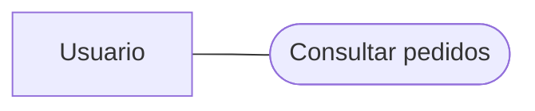

# UML Studio — umlProject-ingSoftware

Editor UML, espacio de estudio de Ingeniería de Software II y laboratorio visual de Git, con interfaz en español.

**Aplicación:** https://uml-studio-ariel.arielfeger.chatgpt.site/

**Teoría y práctica:** https://uml-studio-ariel.arielfeger.chatgpt.site/estudio

## Qué incluye

- Editor Mermaid para clases, secuencia, estados, actividades, casos de uso, componentes y entidad-relación: formularios, edición por código, movimiento, conexiones con el mouse, menú con click derecho, deshacer/rehacer e importación/exportación.
- **DER en notación de Chen** (tipo «DER (Chen)»): entidades y entidades débiles en rectángulo, relaciones e identificadoras en rombo, atributos en elipse (clave subrayada, clave parcial, multivaluado con doble elipse, derivado punteado), cardinalidades junto a cada entidad y razón 1:N / N:M en el rombo. Participación total con línea doble (`===`). Los atributos conectados a una entidad se ubican solos a su alrededor.
- Exportación PNG a 2×, 4×, 6× u 8× (hasta el máximo que admite el navegador), con fondo transparente opcional, y **Ver en alta resolución** en una pestaña vectorial. El lienzo admite zoom hasta 1000% y se vuelve a dibujar nítido al terminar cada gesto.
- Animaciones y controles adaptados a pantallas pequeñas, teclado y preferencias de movimiento reducido.
- 17 temas de teoría, 8 fichas de patrones con estructura y secuencia y 155 ejercicios distribuidos en 5 niveles. Dos parciales originales por año y cuatro simulacros de práctica adicional; 19 actividades de entrenamiento incluyen C++17 de solo lectura y análisis.
- 23 diagramas guiados para aprender: 16 vistas de patrones y 7 mapas de familias, calidad, mejora de procesos, CMMI, cambios, Git y GQM. Pasos con selección de participantes, lectura de flechas, preguntas de comprensión y copias editables en el mismo motor Mermaid.
- Resumen descargable ampliado y 31 documentos originales, incluidas las dos versiones aportadas del resumen de 36 páginas y cuatro imágenes de parciales 2024/2025, en `public/estudio/`.
- Progreso de estudio guardado en el navegador y diagramas guardados por usuario en D1.
- Las copias de referencia se crean al pulsar **Abrir copia editable**; volver a abrirlas conserva las modificaciones. Las prácticas de secuencia permiten código, mensajes origen → destino y formularios, con soluciones orientativas y rúbrica de autoevaluación.
- Git Lab con Working directory, Staging area, historial local y remoto, consola simulada, siete ejercicios, repositorios vacíos y práctica libre.
- Cuatro temas de interfaz: Claro, Grafito, Noche azul y Papel, con selección persistente en el navegador.
- Código fuente, dependencias fijadas, migraciones y pruebas del editor.

Las respuestas de opción múltiple y numéricas tienen corrección automática. Las respuestas de desarrollo y los diagramas se revisan con una rúbrica.

**Copiar y corregir** prepara un texto con consigna, caso o C++ provisto, respuesta del estudiante, borrador Mermaid y criterios para pegar en la IA elegida. No incluye la solución de referencia ni envía información a servicios externos. Si el portapapeles falla, ofrece selección manual y descarga de texto. Durante un simulacro queda disponible al finalizar. Las versiones de C++ son adaptaciones didácticas para leer; no hay un editor ni ejecución de C++ en la app. Se mantienen los identificadores y borradores de ejercicios previos.

**Parciales por año** conserva la consigna y el enunciado completos, en orden y en una sola página: `/estudio?parcial=2025` muestra Teoría 1–5 con puntajes, seguida de Práctica 1–2; `/estudio?parcial=2024` contiene las cuatro preguntas del Word original y la foto. Se preservan el PHP y las referencias a Eiffel de las hojas históricas; las versiones en C++ y ejercicios ampliados se abren como práctica adicional. Las respuestas de los parciales tienen IDs propios y se guardan/importan/exportan sin sobrescribir el trabajo previo de entrenamiento. Se puede copiar una respuesta o el parcial completo para corrección. El tiempo propuesto es de entrenamiento, no una duración oficial.

**Elegir la respuesta correcta** abre `/estudio?modo=opciones`. Incluye 50 nuevas preguntas del resumen y casos de parciales (10 por nivel), para 74 actividades de opción múltiple en total. Cada pregunta nueva tiene cuatro opciones, explicación de la correcta y una explicación específica de cada distractor. Tras una elección incorrecta se explica por qué no encaja, sin marcar el ejercicio como completado. El filtro de tipo permite combinar formato, tema, nivel y pendientes de repaso; Siguiente desafío permanece en opción múltiple mientras ese modo esté seleccionado. Las posiciones de respuestas correctas están distribuidas. Se conservan todos los IDs y el progreso previo; los parciales originales no se modifican.

## Ejecutar en tu computadora

### Editar visualmente

Usá **Insertar** en el explorador o **+ Elemento** en el lienzo para crear elementos con identificador y texto visible. Cada tipo muestra sus opciones: actores y casos de uso, participantes, estados, actividades y decisiones, componentes y bases de datos, o entidades con atributos.

- Arrastrá los elementos para ubicarlos. En secuencia, arrastrá horizontalmente los participantes para cambiar su orden; los mensajes mantienen su orden temporal.
- Elegí **Conectar elementos**, seleccioná origen y destino, y completá el tipo y texto de la conexión. El menú del lienzo y el explorador también permiten crear conexiones por formulario.
- Doble clic o click derecho sobre un elemento para editarlo, duplicarlo o eliminarlo. Seleccioná una conexión para editarla o eliminarla; sus elementos se conservan.
- **Dividir** y **Código** permiten editar Mermaid directamente. Los cambios visuales actualizan el mismo código y se pueden deshacer/rehacer.
- Las declaraciones compuestas, grupos de participantes y estructuras avanzadas siguen disponibles desde Código; una operación que no pueda conservarlos muestra una explicación en lugar de borrar partes del modelo.

Los actores de casos de uso se escriben como `Usuario["Usuario"]:::umlActor` y se muestran como figuras UML, también al exportar SVG o PNG. Los actores rectangulares de las plantillas antiguas, fuera del límite del sistema, se reconocen automáticamente. Un actor de secuencia usa la sintaxis Mermaid `actor Usuario`.



El render de UML Studio sustituye el nodo marcado por un stickman; los visores Mermaid externos pueden mostrar su representación base como rectángulo.

### Deploy en Vercel

Importá `ArielFerger/umlProject-ingSoftware` en Vercel con **Framework Preset: Next.js**, **Root Directory: `./`** y **Node.js: 24.x**. `vercel.json` configura `npm run build:vercel`; dejá el directorio de salida automático de Next.js (`.next`). Si el proyecto ya tenía un override de Vite/Vinext o `dist`, quitá ese override. `npm run build` también elige Next.js cuando Vercel establece `VERCEL=1`.

Esta variante no necesita credenciales de Cloudflare. Los diagramas y las últimas 30 versiones de cada documento se guardan en **IndexedDB de este navegador y dominio**; Estudio, Git y los temas conservan su progreso local. El guardado compara revisiones dentro de una transacción para rechazar cambios obsoletos de otra ventana. La interfaz indica **Guardado en este navegador**. Exportá **Proyecto JSON** para respaldar o trasladar documentos entre dispositivos o dominios; el conector `/mcp` de Sites corresponde a la variante alojada con D1.

Para probar exactamente la compilación de Vercel:

```sh
npm ci --include=dev --include=optional
npm run build:vercel
npm run start:vercel -- --hostname 127.0.0.1 --port 3002
```

Abrí `http://localhost:3002`. Para desarrollo con Next.js: `npm run dev:vercel -- --port 3002`. Las rutas `/`, `/estudio` y `/git` están disponibles. Docker y Sites siguen usando la compilación Worker y su almacenamiento D1, separado del espacio del navegador en Vercel.

Referencias: [deploy de Next.js](https://nextjs.org/docs/pages/getting-started/deploying) y [configuración de compilación de Vercel](https://vercel.com/docs/builds/configure-a-build).

### Compartir tableros online en un VPS

La variante online de Docker incorpora cuentas propias, invitaciones por enlace con lectura o edición, gestión de participantes y sincronización entre navegadores. **Compartir → Proyecto completo** (o el ícono junto al nombre del proyecto) invita a todos los diagramas del proyecto, incluidos los que se agreguen después; los editores del proyecto pueden crear diagramas dentro de él. La cabecera muestra quién está conectado al tablero y el lienzo marca el elemento que cada persona tiene seleccionado. Los diagramas y el historial se guardan en el VPS; **Compartir** abre los permisos del tablero. Los cambios superpuestos conservan el borrador para resolver el conflicto.

Consultá [la instalación online, HTTPS y respaldos](deploy/README.md). Usá `compose.online.yaml` para esta variante; la configuración local de abajo sigue siendo personal.

### Con Docker (uso personal local)

```sh
cd umlProject-ingSoftware
docker compose up --build -d
```

Abrí **http://localhost:3000**. Compose compila la aplicación, aplica las migraciones pendientes e inicia un espacio local de un solo usuario, sin necesitar una cuenta de ChatGPT ni credenciales de Cloudflare. La imagen usa Node.js 24, ejecuta el proceso como usuario `node` y comprueba la salud del Worker y la base D1 local.

Los diagramas y el historial quedan en el volumen `uml-data` y sobreviven a reinicios, reconstrucciones y `docker compose down`. El progreso de estudio se conserva en el navegador. La base local es independiente de los datos del sitio publicado. El puerto se publica sólo en `127.0.0.1`; esta configuración está destinada al uso personal local.

```sh
docker compose logs -f         # Ver los logs
docker compose down            # Detener, conservando los diagramas
UML_PORT=3001 docker compose up -d  # Usar otro puerto local
```

Para respaldar un diagrama, exportalo como **Proyecto JSON** desde la aplicación. Para el curso, usá **Exportar progreso** en `/estudio`. No elimines el volumen si querés conservar los diagramas locales.

### Desarrollo sin Docker

Necesitás Node.js 22.13 o superior y Git. Desde una terminal:

```sh
git clone https://github.com/ArielFerger/umlProject-ingSoftware.git
cd umlProject-ingSoftware
npm run install:ci
npm run build
```

En una instalación nueva, aplicá las dos migraciones a la base local, en este orden:

```sh
node --import ./scripts/sites-env.mjs ./node_modules/wrangler/bin/wrangler.js d1 execute DB --local --config dist/server/wrangler.json --persist-to .wrangler/state --file drizzle/0000_famous_puma.sql
node --import ./scripts/sites-env.mjs ./node_modules/wrangler/bin/wrangler.js d1 execute DB --local --config dist/server/wrangler.json --persist-to .wrangler/state --file drizzle/0001_numerous_ma_gnuci.sql
npm run dev
```

Abrí `http://localhost:5173/signin-with-chatgpt?return_to=%2F` para iniciar la sesión de desarrollo. El estudio está en `/estudio`. El entorno local usa una cuenta de prueba y una base separada de la aplicación publicada.

Para verificar el editor:

```sh
npm test
npm run test:docker
npm run typecheck
```

## Diseño y controles

El rediseño usa Impeccable: `init`, `layout`, `distill`, `typeset`, `animate` y `polish`. El contexto está en `PRODUCT.md`, el sistema visual en `DESIGN.md` y el contrato del editor en `.impeccable/surfaces/components-studio-tsx.md`.

- **Lienzo** es la vista inicial. **Dividir** muestra código y diagrama; **Código** conserva el editor Mermaid completo.
- El explorador reúne los documentos y las herramientas de inserción. El panel derecho muestra propiedades, clases, conexiones y notas.
- Seleccioná una clase para editar sus miembros en el panel. Arrastrala para moverla, o usá las flechas del teclado cuando tiene foco.
- Seleccioná una relación desde la línea, la etiqueta o las multiplicidades. El área de clic conserva su ancho al cambiar el zoom. La selección resalta la flecha y muestra sus extremos; **Editar** o doble clic permite cambiar tipo, etiqueta y multiplicidades. **Tab** recorre las relaciones, **Enter/Espacio** selecciona, **F2** edita y **Escape** deselecciona. Eliminar una relación conserva sus clases y se puede deshacer.
- En la barra de la relación, elegí **Recta**, **Curva** o **En ángulo**. Arrastrá los cuadrados de los extremos a cualquier posición de los cuatro lados de su clase. **Extremos** permite elegir un lado con teclado. Arrastrá el círculo central o pulsá **Punto** para agregar un quiebre; los círculos existentes se pueden mover. Las teclas de dirección mueven el punto seleccionado; **Shift** aumenta el paso y **Supr** lo elimina. El botón menos quita el último punto y Restaurar vuelve al recorrido automático. Hasta 20 puntos por conexión, guardados en `%% uml-studio:` y disponibles al recargar, exportar y deshacer. Los recorridos rodean las dos clases conectadas: Recta usa segmentos rectos adicionales cuando el lado elegido lo requiere, Curva suaviza el recorrido y En ángulo conserva tramos a 90°. Son controles del diagrama de clases; no cambian el significado UML ni invierten una herencia o composición.
- El zoom inicial prioriza la lectura. **Ajustar al lienzo** muestra el diagrama completo; arrastrar el fondo desplaza la vista.
- Las fuentes se sirven localmente: Source Sans 3 para la interfaz e IBM Plex Mono para código y miembros UML. El movimiento reducido conserva el feedback mediante color y opacidad.
- El selector de tema está en la cabecera del editor, Estudio y Git Lab. El lienzo con tema Studio acompaña los temas oscuros; los temas explícitos guardados en un diagrama mantienen su elección.

## Aprender Git

Abrí **http://localhost:3000/git**. Arriba están las cuatro zonas del repositorio y los gráficos de commits con sus padres, ramas, HEAD y referencias `origin/*`. Abajo, la consola permite practicar `init`, `remote add`, `status`, `diff`, `log`, `add`, `restore`, `commit`, `branch`, `switch`, `checkout`, `merge`, `fetch`, `pull` y `push`. **Comandos** muestra el subconjunto de opciones admitidas. Las flechas de comandos rellenan la consola; **Ejecutar** aplica el cambio.

Los siete ejercicios cubren el primer commit, una rama, merge, push, fetch e integración, resolución de conflictos y crear un repositorio desde cero. El objetivo se valida contra el estado del repositorio. Podés editar o crear archivos de práctica, simular un cambio del equipo y seleccionar commits para inspeccionar sus archivos. El progreso y el estado se guardan en este navegador; **Descargar práctica** exporta una copia JSON.

**Nuevo repositorio** crea una carpeta vacía con el nombre que elijas, sin historial ni origin configurado. Ejecutá `git init`, creá un archivo con **+**, preparalo y confirmalo. Después, `git remote add origin <URL>` configura un remoto vacío y simulado; `git push -u origin main` publica su primera rama. Crear otra carpeta reemplaza la práctica actual y conserva los ejercicios completados.

**Autocompletar** se puede activar o desactivar en la consola. Propone comandos, archivos y referencias existentes; **Tab** o un clic inserta la sugerencia, **↑ / ↓** elige y **Esc** la cierra. Las sugerencias no ejecutan comandos. Cuando el menú está cerrado, las flechas recuperan el historial; con **Alt + ↑ / ↓** también accedés al historial mientras hay sugerencias.

Es un simulador educativo: no ejecuta una shell ni modifica el repositorio de tu computadora. La integración compara archivos completos, por lo que dos modificaciones distintas en el mismo archivo pueden requerir resolución manual. `fetch` actualiza referencias remotas sin mover HEAD; `push` rechaza sobrescribir un historial divergente.

Impeccable está instalado localmente en `.agents/skills/impeccable/` (ignorado por Git); sus comandos estarán disponibles en un nuevo turno de Codex. Para instalarlo en otra copia, seguí las instrucciones de [Impeccable](https://impeccable.style/#downloads). El detector se puede ejecutar directamente:

```sh
.agents/skills/impeccable/scripts/impeccable detect --json --no-config app/globals.css app/canvas-interactions.css app/study.css app/git.css app/themes.css app/layout.tsx components/studio.tsx components/class-properties.tsx components/code-editor.tsx components/diagram-preview.tsx components/git-lab.tsx components/theme-picker.tsx
```

El detector verifica patrones de diseño de esas superficies sin excepciones ni reglas silenciadas. La comprobación visual y funcional se realiza por separado.

## Estructura del proyecto

- `app/` y `components/`: pantallas, estilos y editor.
- `lib/`: operaciones UML, persistencia y contenido de estudio.
- `public/estudio/`: resumen y fuentes originales.
- `db/` y `drizzle/`: esquema y migraciones.
- `tests/`: pruebas de metadatos, operaciones sobre clases, simulación Git y adaptador Docker.
- `scripts/` y `build/`: ejecución y configuración de la plataforma.

El repositorio contiene el código y el material del proyecto. Los diagramas personales alojados en D1 y el progreso del navegador se conservan en sus respectivos almacenamientos; podés exportarlos desde la aplicación. Las dependencias instaladas, compilaciones, credenciales y archivos temporales están excluidos mediante `.gitignore`.

La configuración `.openai/hosting.json` identifica la aplicación existente en Sites. Publicar cambios requiere acceso a ese proyecto. Las instrucciones técnicas de la base del proyecto se conservan debajo.

---

# vinext-starter

A clean full-stack starter running on [vinext](https://github.com/cloudflare/vinext), with optional Cloudflare D1 and Drizzle support.

## Prerequisites

- Node.js `>=22.13.0`
- Portable: Windows, macOS, or Linux; no Bash required
- Managed Linux: managed Linux runtime with Bash, `flock`, `curl`, `sha256sum`, and GNU `timeout`
- Git is required only for publishing

## Sites Lifecycle

The Sites initializer copies the shared starter and selects managed-linux only when `SITES_MANAGED_LINUX_CONTAINER=1`; otherwise it selects portable. It saves the selection only in ignored `.sites-runtime/execution-profile.json`. Both profiles copy/configure first, then use the plugin's separate `install-dependencies.mjs` step to measure installation independently. Edit source under `app/` and follow the Sites skill for installation, preview, builds, and publishing.

Run `node <plugin-root>/scripts/configure-execution-profile.mjs` only when the profile is unknown for the current checkout and environment. Profile changes do not alter tracked source or require reinstalling otherwise-valid dependencies; restart an existing preview to use the new selection. Do not commit or upload `.sites-runtime/`.

This starter does not use `wrangler.jsonc`.

`install:ci` runs `npm ci` once against the shared lockfile, disables parent-workspace discovery, and includes required dev/optional dependencies despite production/omit settings. Sharp defaults to prebuilt binaries unless explicitly configured otherwise. Do not overlap installers.

- **Portable:** Preserve host HOME, npm cache, registry, proxy, temporary paths, retry/concurrency settings, and lifecycle-script policy. Use `--prefer-offline --no-audit --no-fund`.
- **Managed Linux:** Use the existing project-local HOME/cache/tmp setup and Linux install lock, tarball preflight, and timeout. Restore the image-seeded npm cache only when its lockfile hash matches; retain network fallback. Builds keep their existing timeout. These helpers are not invoked by the portable profile.

`scripts/sites-env.mjs` preserves the caller's HOME, npm cache, proxy, XDG, and temporary-directory configuration while defaulting Wrangler and Miniflare state to the checkout. If npm reports an unwritable cache, select a writable path with `npm_config_cache` for that install. The `dev` and `start` scripts also keep Wrangler logs inside the checkout. Generated `.sites-runtime/` and `.wrangler/` directories are disposable and ignored by Git.

On portable, `npm run dev` uses `vinext dev` with HMR, starting at port 5173. Vinext records the running server in ignored `.vinext/` state, rejects an ordinary duplicate launch, and recovers stale state after a stopped process; exactly simultaneous starts can race. Pass `--port <port>` or `--hostname <host>` after `npm run dev --` when needed; keep portable previews on loopback.

For browser QA on managed Linux, use `sites-preview start`. The project's dev script runs Vite and accepts the supervisor's `--host 0.0.0.0 --port 4173 --strictPort` arguments. The internal browser uses `http://terminal.local:4173/`; it is not a user-facing URL. The supervisor owns the preview lifecycle. The ignored local profile survives the supervisor's cleared process environment.

The portable profile simulates ChatGPT sign-in only for loopback development requests. Visit `/signin-with-chatgpt?return_to=/` to sign in as `local_seedy` (`seedy@sites.test`, display name `Seedy`) and `/signout-with-chatgpt?return_to=/` to sign out. The development cookie preserves that identity across server restarts. Mock auth is disabled in the managed-linux profile and is not included in production builds; hosted authentication remains dispatch-owned.

The Worker uses `vinext/server/fetch-handler`, including Vinext's config-aware image handling. After building, `npm start` runs that Worker locally through Wrangler on `127.0.0.1`, sharing `.wrangler/state` with dev preview and local D1 migrations; it does not deploy the site or simulate sign-in. Use the URL printed by the server. Pass `npm start -- --port <port>` to select a different built-preview port.

Local previews use Miniflare's placeholder `Request.cf` metadata without a network lookup. Set `CLOUDFLARE_CF_FETCH_ENABLED=true` to opt into fetching preview metadata; this setting does not change hosted request metadata.

Local tool usage metrics are disabled by default. Set `WRANGLER_SEND_METRICS=true` to opt in.

## Included Shape

- edit site code under `app/`
- `app/chatgpt-auth.ts` provides optional dispatch-owned ChatGPT sign-in helpers
- `.openai/hosting.json` declares optional Sites D1 and R2 bindings
- `vite.config.ts` simulates declared bindings for local development
- `db/index.ts` reads the D1 binding from the Cloudflare Worker environment
- `db/schema.ts` starts intentionally empty
- `@cloudflare/workers-types` provides Worker types; `cloudflare-env.d.ts` declares optional `DB`/`BUCKET` bindings—update these declarations if binding names change
- `examples/d1/` contains an optional D1 example surface
- `drizzle.config.ts` supports local migration generation when needed

## Workspace Auth Headers

Signed-in visitors receive both `oai-authenticated-user-id` and `oai-authenticated-user-email`. Private Sites require every visitor to sign in; public Sites may also have anonymous visitors, for whom neither header is present.

The user ID is stable for the same user on the same Site and different across Sites. Use it as the durable user key; use email and name for display or contact purposes.

SIWC-authenticated workspace sites may also receive `oai-authenticated-user-full-name` when the user's SIWC profile has a non-empty `name` claim. The full-name value is percent-encoded UTF-8 and is accompanied by `oai-authenticated-user-full-name-encoding: percent-encoded-utf-8`.

Treat the full name as optional and fall back to email when it is absent:

```tsx
import { headers } from "next/headers";

export default async function Home() {
  const requestHeaders = await headers();
  const userId = requestHeaders.get("oai-authenticated-user-id");
  const email = requestHeaders.get("oai-authenticated-user-email");
  const encodedFullName = requestHeaders.get("oai-authenticated-user-full-name");
  const fullName =
    encodedFullName &&
    requestHeaders.get("oai-authenticated-user-full-name-encoding") ===
      "percent-encoded-utf-8"
      ? decodeURIComponent(encodedFullName)
      : null;

  const displayName = fullName ?? email;
  // ...
}
```

## Optional Dispatch-Owned ChatGPT Sign-In

Import the ready-to-use helpers from `app/chatgpt-auth.ts` when the site needs optional or required ChatGPT sign-in:

- Use `getChatGPTUser()` for optional signed-in UI.
- Use the returned `userId` as the stable user key for user-owned records; do not use email as a durable identifier.
- Use `requireChatGPTUser(returnTo)` for server-rendered pages that should send anonymous visitors through Sign in with ChatGPT.
- In a Server Component, start sign-in with `<a href={chatGPTSignInPath(returnTo)} target="_top">`. The auth helper module is server-only; do not import it into a Client Component.
- Do not use `fetch`, XHR, a client-side router, or a framework link that can prefetch the sign-in route. SIWC must start as a top-level navigation.
- Never request the AuthAPI authorization endpoint directly. The dispatch-owned `/signin-with-chatgpt` route must start the SIWC flow.
- Use `chatGPTSignOutPath(returnTo)` for browser sign-out links or actions.
- Pass a same-origin relative `returnTo` path for the destination after sign-in or sign-out. The helper validates and safely encodes it.
- Mark protected pages with `export const dynamic = "force-dynamic"` because they depend on per-request identity headers.

Dispatch owns `/signin-with-chatgpt`, `/signout-with-chatgpt`, `/callback`, the OAuth cookies, and identity header injection. Do not implement app routes for those reserved paths. Routes that do not import and call the helper remain anonymous-compatible.

SIWC establishes identity only; it does not prove workspace membership. Use the Sites hosting platform's access policy controls for workspace-wide restrictions, or enforce explicit server-side membership or allowlist checks.

Use SIWC for account pages, user-specific dashboards, saved records, and write actions tied to the current ChatGPT user. Leave public content anonymous.

## Local D1 migrations

For a D1-backed local preview, generate SQL with `npm run db:generate`. Build once through the Sites skill's build entrypoint (or `npm run build` for standalone use) to generate `dist/server/wrangler.json`, rebuilding if bindings change. From the project root, apply each pending migration in order:

```sh
node --import ./scripts/sites-env.mjs ./node_modules/wrangler/bin/wrangler.js d1 execute DB --local --config dist/server/wrangler.json --persist-to .wrangler/state --file drizzle/0000_example.sql
```

Replace the filename with the pending migration and `DB` with your D1 binding name if different. Use `.wrangler/state`, not `.wrangler/state/v3`; Wrangler adds the versioned directories. Do not replay migrations already applied locally. This updates only the preview database; publishing applies production migrations separately.

## Diagnostic Commands

- `npm run install:ci`: perform the one locked dependency install
- `npm run dev`: start the Vite/Vinext development server
- `npm run build`: build the deployable Sites artifact
- `npm run start`: preview the built Worker locally with D1/R2 support
- `npm run db:generate`: generate Drizzle migrations after schema changes

When using the Sites plugin, follow its skill instructions for installation, builds, and publishing. These npm commands remain available for standalone use.

The portable build runs Vinext directly without a host `timeout` command. The managed-linux build uses `scripts/build-verified.sh` and its existing `SITES_BUILD_TIMEOUT` setting.

## Learn More

- [vinext Documentation](https://github.com/cloudflare/vinext)
- [Drizzle D1 Guide](https://orm.drizzle.team/docs/get-started/d1-new)

## Marcos de módulos

En un diagrama de clases, el botón **Crear marco de módulo** agrega un sector detrás de las clases. Seleccioná su encabezado para cambiar título, color y borde (continuo, discontinuo o punteado), o ingresá ancho y alto. Arrastrá los tiradores para redimensionar y el encabezado para mover. La opción **Mover también las clases que contiene** incluye únicamente las clases completamente encerradas. Eliminar un marco conserva las clases.

Desde el panel del marco podés crear flechas hacia otro marco o una clase; seleccioná la flecha para editar etiqueta, color, trazo y dirección. Las conexiones entre módulos pasan por arriba para separarse de las relaciones UML. Marcos y flechas se guardan como anotaciones del lienzo, se comparten y se incluyen en Mermaid/JSON y en SVG/PNG. Las operaciones usan el historial del editor.
