# Ingeniería de Software II
Resumen para estudiar teoría y resolver la práctica

Material de base y ampliaciones: 30 documentos, 219 páginas PDF, 3 archivos Word y 4 imágenes de parciales. Las soluciones son propuestas didácticas elaboradas para estudiar, no un solucionario oficial. Las referencias de páginas PDF cuentan desde la primera hoja del archivo.

## Cómo usarlo
1. Leé Fundamentos y UML.
2. Estudiá las ocho fichas de patrones.
3. Pasá por calidad, procesos, CMMI y métricas.
4. Repasá Git, Docker y agentes.
5. Practicá por niveles en el sector Estudio IS II de UML Studio.

### Casos y código de los parciales

#### Parciales por año: conservar la hoja original

En Simulacros, **Parciales por año** abre cada examen completo, con consigna, enunciado y respuesta de cada pregunta en orden. El de 2025 presenta primero Teoría (SoftMetrics, preguntas 1–5 con sus puntajes) y después Práctica (Muebles Express y código, preguntas 1–2). El de 2024 se recupera de la foto y del Word original: incluye cuatro preguntas, el diagrama farmacéutico y la continuación del código de Operador. El caso de Muebles Express se conserva íntegro en tres párrafos; la pregunta pide identificar y justificar patrones, sin añadir un requisito de UML.

La vista histórica mantiene el lenguaje y el texto de las hojas, incluidos PHP y la referencia a Eiffel. Los bloques son de lectura y no se ejecutan. Las adaptaciones en C++ y las actividades ampliadas quedan en **práctica adicional**. Las respuestas de los parciales se guardan aparte de esos ejercicios, con exportación/importación en la copia de progreso. Podés copiar una respuesta con su consigna original o copiar el parcial completo para pedir una corrección. Los intentos con tiempo son de entrenamiento y no modifican la duración oficial ni el texto original.

Estudio incorpora las imágenes de los parciales de 2024 y del 8 de octubre de 2025, con adaptaciones de sensores, farmacia, Muebles Express y SoftMetrics. Los originales se conservan en Material original. Los textos de empresa se trabajan separando requisitos, participantes, responsabilidades y consecuencias de cada decisión; no basta con enumerar patrones.

Las 16 actividades con código usan C++17 para **leer y analizar**, incluso las versiones de ejemplos originalmente escritos en PHP, C# o Eiffel. No tenés que escribir ni ejecutar C++ en la aplicación. Identificá el patrón y sus roles, seguí llamadas y salida, revisá vida útil y supuestos y explicá cómo se relacionan con el caso. Cuando se pide diseñar, respondé con texto o con el motor UML.

Hay 19 actividades nuevas de empresas y lectura de código; el recorrido tiene 105 desafíos y 6 simulacros. Se conservan los identificadores de ejercicios anteriores, sus respuestas y progreso. Los simulacros usan tiempos propuestos para entrenar, no duraciones oficiales.

### Corregir tu respuesta con una IA

Después de responder, pulsá **Copiar y corregir**. Copia título, caso, consigna, código provisto si corresponde, tu razonamiento, tu borrador UML y criterios de revisión. Pegá el texto en la IA que elijas para recibir una explicación de aciertos, errores y mejoras. No se incluye la solución orientativa de la aplicación ni se envía nada automáticamente. Si el navegador bloquea el portapapeles, podés seleccionar/copiar el texto manualmente o descargarlo. Durante un simulacro esperá a finalizar para usar este recurso.

## Cómo pensar un patrón

Primero encontrá qué cambia y qué necesita permanecer estable. Después elegí la estructura.

### Qué es y qué no es

Un patrón describe una solución de diseño recurrente: propósito, contexto, participantes, responsabilidades, relaciones y consecuencias. No es una biblioteca lista para copiar ni un algoritmo con una secuencia fija. El mismo patrón tiene implementaciones distintas según el lenguaje y el problema.

### Tres familias


| Familia | Pregunta que responde | Patrones centrales de estas guías |
| --- | --- | --- |
| Creacional | ¿Cómo y quién crea los objetos? | Singleton, Factory Method, Abstract Factory |
| Estructural | ¿Cómo se ensamblan clases y objetos? | Adapter, Composite, Facade |
| Comportamiento | ¿Cómo colaboran y distribuyen responsabilidades? | Observer, Strategy |

### Principios que explican las ventajas


- Responsabilidad única: separar construcción, traducción, notificación y negocio cuando cambian por motivos diferentes.
- Abierto/cerrado: agregar variantes extendiendo abstracciones, evitando modificar al cliente estable.
- Inversión de dependencias: el cliente usa interfaces, no implementaciones concretas.
- Polimorfismo: distintas implementaciones responden al mismo contrato.
- Composición de objetos: delegar a un objeto intercambiable; herencia: especializar una clase. Elegí por el cambio que necesitás soportar.
- Los patrones dan un lenguaje común, pero aplicarlos sin necesidad agrega complejidad. El catálogo GoF reúne 23 patrones; el material profundiza ocho.

### Método para cualquier ejercicio


- Subrayá cada requisito y separá responsabilidades.
- Identificá la variación: cantidad de instancias, construcción, contrato incompatible, árbol, evento o algoritmo.
- Asigná un patrón solo al requisito que resuelve.
- Nombrá participantes con clases del dominio y ubicá métodos y atributos relevantes.
- Dibujá relaciones y multiplicidades; explicá cómo una llamada recorre la solución.
- Justificá una ventaja concreta y un costo. Revisá si una asociación simple alcanza.

Fuentes: Introducción patrones de diseño.pdf, 02 - Creacionales - Patrones de diseño.pdf, 03 - Estructurales - Patrones de diseño.pdf, 04 - Comportamiento - Patrones de diseño.pdf

## UML para resolver las guías

Un diagrama debe mostrar la estructura que hace funcionar la solución.

### Clases y miembros

Una clase tiene nombre, atributos y métodos. + indica público, - privado, # protegido. En UML tradicional los miembros estáticos se subrayan; en Mermaid se marcan con $ al final. <<interface>> identifica un contrato y <<abstract>> una abstracción no instanciable.

### Relaciones


| Relación | Mermaid | Lectura |
| --- | --- | --- |
| Herencia | Base <|-- Hija | Hija es una Base; triángulo en Base |
| Realización | Contrato <|.. Clase | Clase implementa Contrato |
| Asociación | A --> B | A mantiene una referencia o conoce a B |
| Dependencia | A ..> B | A usa B temporalmente, por ejemplo lo crea o recibe como parámetro |
| Agregación | Todo o-- Parte | Todo agrupa partes con vida independiente; rombo vacío en Todo |
| Composición | Todo *-- Parte | Todo controla la vida de las partes; rombo lleno en Todo |

### Multiplicidades

1 = exactamente uno; 0..1 = opcional; 0..* = cero o muchos; 1..* = uno o muchos. Profesor "1" --> "0..*" Estudiante expresa un profesor para cada estudiante y muchos estudiantes por profesor. No exige que haya un único Profesor en todo el programa.

### Errores frecuentes


- Dibujar solo herencia y olvidar la referencia que permite delegar (Strategy, Adapter).
- Un Composite debe contener Componentes, no solo hojas, para admitir anidación.
- El Observer debe conocer la interfaz de sus observadores, sin acoplarse a todos los concretos.
- En Abstract Factory hacen falta abstracciones de producto y variantes coherentes.
- Agregación UML y composición de objetos son conceptos diferentes del nombre del patrón Composite.

Fuentes: 02 - Creacionales - Patrones de diseño.pdf, 03 - Estructurales - Patrones de diseño.pdf, 04 - Comportamiento - Patrones de diseño.pdf, Guia Nº1 Ejercicios - Patrones crecionales.pdf, Guia Nº2 Ejercicios - Patrones estructurales.docx, Guia Nº3 Ejercicios - Patrones de comportamiento.docx, practica 1 patrones.pdf, practica 2 patrones.pdf

## Creación de objetos

Estudiá el propósito, reconocé los participantes y probá la ficha UML de cada patrón.

### Singleton

Controla que una clase tenga una única instancia y ofrece un acceso global a ella.

- Señal: La consigna exige una única instancia de una CLASE en el ámbito de la aplicación.
- Participantes: Singleton: instancia estática privada, constructor privado y obtenerInstancia() estático público. Cliente: solicita esa instancia.
- Ejemplo: Configuración global, gestor de usuarios o administrador de conexión de las guías.
- Ventaja: Centraliza un recurso compartido y controla la creación.
- Costo: Introduce estado global, dependencias difíciles de probar y problemas de concurrencia si se inicializa sin sincronización.
- Cuidado: Una relación de multiplicidad 1 no convierte una clase en Singleton. Tener un gestor único tampoco significa una sola conexión física o una sola instancia en toda una red.

### Factory Method

Delega a subclases creadoras qué producto concreto instanciar, devolviendo una abstracción común.

- Señal: Cambia el tipo de producto y el cliente no debe conocer sus constructores.
- Participantes: Producto, ProductosConcretos, Creador con crearProducto(), CreadoresConcretos que redefinen ese método.
- Ejemplo: Concesionaria: fábricas de auto, moto y camioneta; enemigos: fábricas de orco, troll y goblin.
- Ventaja: Separa creación y uso; permite agregar productos con nuevos creadores.
- Costo: Puede aumentar mucho la cantidad de subclases.
- Cuidado: Mover un new a un método con switch es una fábrica simple; para mostrar Factory Method GoF, incluí la redefinición en creadores concretos.

### Abstract Factory

Crea familias de productos relacionados y compatibles sin exponer sus clases concretas.

- Señal: Hay varios tipos de producto y variantes de familia que deben combinar entre sí.
- Participantes: FabricaAbstracta, FabricasConcretas (una por variante), ProductosAbstractos (uno por tipo) y ProductosConcretos para cada combinación.
- Ejemplo: Interfaz gráfica: botón y campo de texto, ambos web o ambos escritorio.
- Ventaja: Garantiza consistencia de familia y desacopla al cliente de variantes concretas.
- Costo: Agregar un nuevo tipo de producto obliga a ampliar la interfaz de fábrica y todas sus implementaciones.
- Cuidado: Una lista de productos heterogéneos no basta: explicitá la matriz tipos × variantes. La guía de música/computación necesita justificar qué familia relacionada produce cada fábrica.

Fuentes: 02 - Creacionales - Patrones de diseño.pdf, Ejercicios de patrones.pdf, Ejercicios_patrones_singleton_subir.pdf, Guia Nº1 Ejercicios - Patrones crecionales.pdf

## Estructuras flexibles

Estudiá el propósito, reconocé los participantes y probá la ficha UML de cada patrón.

### Adapter

Traduce la interfaz de una clase existente a la interfaz que espera el cliente.

- Señal: Una biblioteca, API o clase útil tiene métodos incompatibles con el sistema.
- Participantes: Cliente, Target (contrato esperado), Adapter (implementa Target) y Adaptee (servicio adaptado).
- Ejemplo: LibroDigitalAdapter implementa Administrable y delega vender() a LibroDigital. Adaptadores VISA y MasterCard implementan una autorización común.
- Ventaja: Reutiliza código existente; separa traducción y negocio.
- Costo: Agrega intermediarios; las operaciones que la biblioteca no ofrece necesitan una política explícita.
- Cuidado: Adapter no inventa capacidades inexistentes. Si una biblioteca solo dibuja círculos, traducir nombres de métodos no permite dibujar cuadrados por arte de magia.

### Composite

Representa un árbol de objetos simples y compuestos con una interfaz común.

- Señal: Carpetas dentro de carpetas, organismos hijos, expresiones formadas por expresiones o colecciones anidadas.
- Participantes: Componente: operación común. Hoja: caso simple. Compuesto: colección de Componentes y operación recursiva. Cliente: usa Componente.
- Ejemplo: Archivo.tamano() devuelve su tamaño; Carpeta.tamano() suma el tamaño de sus hijos, que pueden ser archivos o carpetas.
- Ventaja: Permite recorrer árboles uniformemente con polimorfismo y recursión.
- Costo: Puede forzar una interfaz demasiado general y requiere impedir ciclos.
- Cuidado: Composite es el patrón; composición UML es una relación. Elegí rombo lleno solo si el padre controla el ciclo de vida de sus hijos.

### Facade

Ofrece una entrada simple a un subsistema complejo y coordina llamadas internas.

- Señal: El cliente debe invocar una operación simple que organiza varios subsistemas.
- Participantes: Cliente, Fachada con operación de alto nivel y Subsistemas que realizan el trabajo.
- Ejemplo: TiendaFacade.comprar() coordina inventario, pedidos y envíos. YouTubeDownloader coordina YouTube y FFMpeg.
- Ventaja: Reduce el conocimiento que necesita el cliente sobre el subsistema.
- Costo: Una fachada con demasiadas tareas puede convertirse en un objeto con responsabilidades excesivas.
- Cuidado: Una interfaz simplificada no implica por sí sola adaptar una incompatibilidad. Adapter traduce contratos; Facade simplifica una entrada.

Fuentes: 03 - Estructurales - Patrones de diseño.pdf, Guia Nº2 Ejercicios - Patrones estructurales.docx, practica 2 patrones.pdf, Practica_03_patrones_subir.pdf

## Comunicación y algoritmos

Estudiá el propósito, reconocé los participantes y probá la ficha UML de cada patrón.

### Observer

Notifica a suscriptores cuando ocurre un evento o cambia un estado del sujeto.

- Señal: Al cambiar un objeto, deben reaccionar varios receptores; se pueden agregar alertas sin modificar el emisor.
- Participantes: Sujeto: suscribir(), desuscribir(), notificar() y colección de Observers. Observer: actualizar(evento). ObservadoresConcretos: reacciones.
- Ejemplo: Archivo notifica a exportadores CSV, XLS y PDF; movimiento notifica al auditor y al administrador.
- Ventaja: Desacopla emisor y receptores; permite suscripciones dinámicas y nuevas reacciones.
- Costo: Exige manejar bajas, referencias, errores de receptores y posibles cascadas de eventos. No presupongas un orden de notificación.
- Cuidado: Notificar a varios receptores no es elegir un único algoritmo. Gestioná suscripción y baja.

### Strategy

Encapsula variantes de un algoritmo bajo un contrato común y permite intercambiarlas.

- Señal: Se puede hacer la misma tarea de distintas maneras: ordenar, frenar, calcular presupuesto o elegir una ruta.
- Participantes: Contexto: guarda una Estrategia y delega. Estrategia: algoritmo común. EstrategiasConcretas: variantes. Cliente: selecciona la estrategia.
- Ejemplo: Coche tiene IComportamientoFrenos; FrenoNormal y FrenoABS implementan frenar().
- Ventaja: Aísla algoritmos, permite sustituirlos en ejecución y evita condicionales crecientes en el contexto.
- Costo: El cliente necesita saber qué variante elegir; demasiadas clases son innecesarias para casos triviales.
- Cuidado: Observer dispara varias reacciones; Strategy delega una tarea a la estrategia elegida. El triángulo apunta a la abstracción, no a la clase concreta.

Fuentes: 04 - Comportamiento - Patrones de diseño.pdf, Guia Nº3 Ejercicios - Patrones de comportamiento.docx, practica 2 patrones.pdf

## Otros patrones del catálogo

Sirven para reconocer el panorama; las guías desarrollan principalmente los ocho de las fichas.

### Patrones mencionados


| Patrón | Idea central | Distinción útil |
| --- | --- | --- |
| Builder | Construir un objeto complejo por pasos | Configuración paso a paso, no creación de familias |
| Prototype | Crear copiando un objeto existente | Atender referencias y copias profundas |
| Decorator | Agregar responsabilidades envolviendo un objeto | Conserva el contrato; Adapter lo traduce |
| Proxy | Controlar acceso mediante un sustituto | Usa el contrato del servicio |
| Command | Representar una solicitud como objeto | Permite cola, historial o deshacer si se implementa la reversión |
| Template Method | Fijar el esqueleto del algoritmo y redefinir pasos | Usa herencia; Strategy usa composición |

### Evitar confusiones

Una fábrica puede construir un árbol Composite. Una fachada puede usar adaptadores. Un Singleton puede gestionar un sujeto Observer. Los patrones se pueden combinar porque atienden requisitos distintos; nombrarlos sin explicar su responsabilidad no alcanza.

Fuentes: Introducción patrones de diseño.pdf

## Calidad del producto y del proceso

Calidad significa cumplir requisitos y necesidades de forma útil, confiable y mantenible.

### Por qué importa

La calidad afecta satisfacción, costos, reputación, seguridad y capacidad de evolución. Corregir defectos tarde genera retrabajo, retrasos y costos. Ausencia de fallos no garantiza usabilidad ni eficiencia.

### Atributos de calidad


| Atributo | Qué evaluás | Ejemplo verificable |
| --- | --- | --- |
| Funcionalidad / adecuación funcional | Corrección y cobertura de funciones | Calcula correctamente un turno o un total |
| Fiabilidad | Continuidad y recuperación ante fallos | Se recupera de una interrupción sin perder datos |
| Usabilidad | Aprendizaje y facilidad de interacción | Usuarios completan una tarea con pocos errores |
| Eficiencia | Respuesta y consumo de recursos | Latencia p95 menor que el objetivo establecido |
| Mantenibilidad | Facilidad de entender, cambiar y probar | Una modificación se implementa sin afectar módulos ajenos |
| Portabilidad | Adaptación a entornos | Mismo paquete ejecutable en ambientes compatibles |
| Seguridad | Protección y acceso autorizado | Operaciones sensibles requieren permisos correctos |
| Compatibilidad | Coexistencia e intercambio | Intercambia datos mediante contratos acordados |

### Marcos y prácticas


| Marco / enfoque | Función en el material |
| --- | --- |
| ISO 9001 | Gestión de calidad organizacional |
| CMMI | Mejora y madurez de procesos |
| Agile: Scrum, Kanban, XP | Iteración, colaboración, feedback y adaptación |
| ITIL | Gestión de servicios de TI |
| IEEE 730 | Aseguramiento de calidad de software |
| Six Sigma | Reducir defectos y variabilidad con datos |
| DevOps | Colaboración desarrollo/operaciones y automatización |

### Técnicas de mejora


- Pruebas unitarias, de integración, sistema y aceptación: diferentes alcances de verificación.
- Automatizar regresiones repetitivas; probar carga, rendimiento y seguridad.
- Revisiones por pares y análisis estático; registrar y corregir hallazgos.
- Controlar versiones, configuraciones y dependencias.
- Refactorizar conservando comportamiento; documentar código y uso.
- Planificar riesgos, comunicar requisitos y monitorear producción.
- IA puede apoyar revisión y pruebas; sus propuestas necesitan validación humana.

### Versiones del modelo de calidad

El apunte de métricas utiliza explícitamente ISO/IEC 25010:2011 y sus ocho características. Esta guía conserva ese marco para estudiar el material de la cátedra; no presenta esa enumeración como un inventario de toda edición posterior de la norma.

Fuentes: Calidad de software.pdf, IS2 - Calidad de Software - Ejercicios prácticos.pdf, Métricas_compressed.pdf

## Mejorar procesos y organizar equipos

Un proyecto de mejora cambia cómo se trabaja; un proyecto de desarrollo entrega un producto.

### PI, BPI y SPI


| Concepto | Alcance | Ejemplo |
| --- | --- | --- |
| PI | Mejora general de procesos | Reducir demoras de un trámite |
| BPI | Procesos del negocio | Mejorar facturación o atención |
| SPI | Desarrollo y mantenimiento de software | Incorporar revisión y CI |

### Ciclo de mejora

Relevá el AS-IS (situación actual), diagnosticá causas y cuellos de botella, definí objetivos cuantificables, diseñá el TO-BE (situación objetivo), implementá con capacitación y medí los resultados. PDCA: planificar, hacer, verificar y actuar. Una herramienta nueva solo es una mejora si produce el resultado esperado.

### Tres dimensiones

Personas: conocimiento, participación y capacitación. Métodos: procedimientos, responsabilidades y criterios. Herramientas: soporte para ejecutar, medir y controlar. Deben funcionar juntas.

### Roles


| Rol | Responsabilidad |
| --- | --- |
| Sponsor | Da apoyo, recursos y autoridad |
| Jefe de proyecto | Coordina alcance, tiempos, recursos y riesgos |
| Analista de procesos | Releva AS-IS y diseña mejoras |
| Especialista técnico | Implementa soporte tecnológico |
| Usuario clave | Valida desde el trabajo real |
| Calidad / SQA | Comprueba cumplimiento y buenas prácticas |
| Grupo de procesos / EPG | Define y mantiene procesos organizacionales |
| Equipo de métricas | Analiza datos y apoya decisiones |

### Diferenciar proyectos

Desarrollo: requisitos → análisis y diseño → código → pruebas → despliegue → mantenimiento. Mejora: diagnóstico → objetivos → rediseño → adopción → evaluación. Pueden estar relacionados: desarrollar software puede apoyar una mejora; automatizar un proceso defectuoso no lo corrige automáticamente.

Fuentes: Calidad de software.pdf

## CMMI a partir de evidencias

Diagnosticá prácticas observables. Las herramientas por sí solas no determinan un nivel.

### Los cinco niveles de las guías


| Nivel | Nombre | Evidencia característica | Paso siguiente |
| --- | --- | --- | --- |
| 1 | Inicial | Trabajo reactivo, depende de personas, sin planificación común | Gestionar requisitos, plan, responsables y seguimiento por proyecto |
| 2 | Gestionado | Proyectos planificados, requisitos y cambios registrados | Proceso estándar de la organización, capacitación y adaptación controlada |
| 3 | Definido | Proceso organizacional aplicado y adaptado con criterios | Modelos, baselines y control estadístico de variación |
| 4 | Cuantitativamente gestionado | Se conoce el comportamiento esperado y se anticipan desvíos con datos | Análisis causal y mejoras sistemáticas verificadas |
| 5 | En optimización | Innovaciones y prevención, evaluadas y extendidas con resultados | Mantener y evolucionar la mejora continua; no hay nivel 6 en este esquema |

### Pistas decisivas

Documentar un proceso sin institucionalizarlo no prueba el nivel 3. Recopilar métricas y mostrar informes no prueba el nivel 4. Usar IA o automatizar una tarea no prueba el nivel 5. Se necesita evidencia de uso, gestión de variación y mejora causal sostenida.

### Casos de la práctica CMMI

Clínica: pasa de prácticas iniciales a gestión de proyecto; el diagnóstico didáctico actual apunta a 2, aunque un solo proyecto no demuestra por sí solo madurez institucional de toda la empresa. Universidad: 2 porque cada proyecto tiene procedimientos propios. Servicios tecnológicos: 3 porque comparte procesos, pero solo informa métricas sin modelos estadísticos. Banco: 4 por rangos históricos y alertas de desvíos. Fábrica de software: 5 por análisis causal, pruebas de mejora y adopción de cambios comprobados.

### SoftMetrics del parcial

El enunciado menciona procesos documentados con aplicación desigual. Una respuesta defendible propone nivel 2 si no hay un estándar organizacional institucionalizado; también puede argumentarse cercanía al 3 si se interpreta que el proceso común ya existe. Debés declarar el supuesto, citar evidencia y reconocer que no se demuestra nivel 4: no hay gestión cuantitativa. El caso no equivale a una evaluación formal CMMI.

### Tres acciones hacia el nivel 5 con IA


- Institucionalizar un proceso común, capacitar y auditar su aplicación (base del 3); usar IA para borradores de documentación, con revisión.
- Definir métricas, datos confiables, baselines y modelos para gestionar variación y anticipar riesgos (4); validar predicciones de IA con datos nuevos.
- Analizar causas de defectos, experimentar mejoras como pruebas asistidas por IA, medir antes/después y estandarizar las efectivas (5).

Fuentes: Calidad de software.pdf, IS2 - Calidad de Software - Ejercicios prácticos.pdf, Practica 2  CMMI.pdf, Parcial N°2 - 8 de octubre.pdf

## Medidas métricas e indicadores

Cada número necesita atributo, unidad, contexto y una decisión que pueda orientar.

### Cinco conceptos


| Concepto | Definición operativa | Ejemplo |
| --- | --- | --- |
| Atributo | Propiedad de interés | Mantenibilidad o rapidez de resolución |
| Medida | Valor cuantificado de un atributo | 1260 horas empleadas; 378 incidentes resueltos |
| Unidad | Escala que da sentido al valor | Horas, incidentes, porcentaje, defectos/KLOC |
| Métrica | Regla de medición o relación entre medidas | Tiempo medio = horas/resueltos |
| Indicador | Métrica interpretada frente a meta, umbral o tendencia | Tiempo medio supera la meta de 3 horas: investigar causas |

### Aplicación

Producto: calidad del software. Proceso: cómo se desarrolla o mantiene. Proyecto: planificación, esfuerzo y avance. Una misma medida puede apoyar varias preguntas, pero necesitás declarar el alcance y período.

### Ciclo de medición

Planificación → definición → recolección → análisis → comunicación → revisión. Definí procedimientos, responsables, unidad, frecuencia y criterios. Asegurá consistencia de datos; compará resultados con objetivos y revisá si la métrica sigue siendo útil.

### GQM y otros modelos

GQM va de Goal (objetivo) a Question (pregunta) a Metric. Ejemplo: reducir retrabajo → ¿qué módulos concentran defectos reabiertos? → tasa de reapertura por módulo. GQM+Strategies conecta esos objetivos con la estrategia de negocio. BSC mira finanzas, clientes, procesos internos y aprendizaje. ISO/IEC 25010 orienta atributos de producto; CMMI, procesos; ITIL, servicios. SW-CMM es un antecedente de CMMI.

### Buen uso y mal uso

Las métricas ayudan a decidir, controlar y aprender. Medir todo genera ruido. Premiar líneas de código o cantidad de commits puede incentivar volumen sin valor. No compares story points entre equipos ni uses cobertura como prueba de ausencia de errores. Combiná cantidad, calidad y contexto.

Fuentes: Métricas_compressed.pdf, Practica_Metricas_3_Enunciados.pdf, Parcial N°2 - 8 de octubre.pdf

## Fórmulas y práctica numérica

Escribí fórmula, reemplazo, resultado con unidad e interpretación.

### Métricas por tamaño


| Métrica | Fórmula | Interpretación contextual |
| --- | --- | --- |
| Productividad | Tamaño / esfuerzo | Más tamaño por unidad de esfuerzo; comparar contexto y tecnología |
| Densidad de errores | Errores / tamaño | Menor densidad suele ser favorable; depende de detección y severidad |
| Costo unitario | Costo / tamaño | Menor costo por unidad de tamaño |
| Documentación | Páginas / tamaño | Mayor densidad no garantiza mejor documentación |

### Ambigüedad de la tabla KLDC

La práctica rotula KLDC y escribe 14.500 y 21.200; no especifica unidad de esfuerzo. Para aprender usamos el supuesto explícito de 14 500 y 21 200 líneas de código, es decir 14,5 y 21,2 KLOC, con esfuerzo 28 y 44 unidades. Si el docente confirma que eran ya KLDC, hay que recalcular. No inventes persona-mes sin que se informe.

### Resultados con ese supuesto


| Proyecto | KLOC/esfuerzo | Errores/KLOC | $/KLOC | Páginas/KLOC |
| --- | --- | --- | --- | --- |
| Biblioteca | 14,5/28 = 0,5179 | 36/14,5 = 2,4828 | 315000/14,5 = 21724,14 | 160/14,5 = 11,0345 |
| Turnos | 21,2/44 = 0,4818 | 58/21,2 = 2,7358 | 528000/21,2 = 24905,66 | 245/21,2 = 11,5566 |

### Comparación

Con igual unidad de esfuerzo, Biblioteca tiene mayor productividad, menor densidad de errores y menor costo por KLOC. Turnos tiene más páginas por KLOC; eso indica densidad documental, no superioridad de calidad por sí sola. La cantidad de personas no se multiplica por el esfuerzo si este ya representa trabajo total.

### Puntos de función

Cuenta sin ajustar = Σ(cantidad × peso). Para Inscripciones: 9×4 + 12×5 + 18×4 + 7×10 + 3×7 = 259. Los 14 Fi suman 45. Factor = 0,65 + 0,01×45 = 1,10. PF = 259×1,10 = 284,9. Es el método de ajuste solicitado por esta guía. Para obtener PF/esfuerzo, defectos/PF, $/PF y páginas/PF faltan esfuerzo, defectos, costo y documentación.

### Mesa de ayuda

Medidas directas: 420 recibidos, 378 resueltos, 42 pendientes, 1260 horas, 31 reabiertos y satisfacción 4,2/5. Tasa de resolución = 378/420×100 = 90 %. Pendientes/recibidos = 10 %. Tiempo medio = 1260/378 = 3,333 h por resuelto. Reaperturas/resueltos = 31/378×100 = 8,20 % bajo el supuesto de que los reabiertos pertenecen a esos cierres. Satisfacción normalizada = 4,2/5×100 = 84 %, no porcentaje de usuarios satisfechos. Una meta de resolución ≥95 % daría alerta con 90 %; ese umbral es un ejemplo didáctico, no un dato de la consigna.

### Complejidad ciclomática

V(G)=E−N+2P. En una función con grafo conectado, P=1. Para decisiones binarias modeladas como un nodo, suele equivaler a decisiones+1. Par/impar tiene un if: V=2. En el ejemplo de primalidad hay cuatro if y un while: V=6 al contar cada condición compuesta como una decisión; si se modela cada or de cortocircuito, suma dos decisiones adicionales y V=8. Definí la convención y el alcance: el if del programa que imprime el resultado está fuera de la función es_primo.

Fuentes: Practica_Metricas_3_Enunciados.pdf, Métricas_compressed.pdf

## Métricas de software y aprendizaje automático

Elegí medidas según el problema: velocidad, calidad, confiabilidad o capacidad predictiva.

### Software


| Grupo | Métricas e interpretación |
| --- | --- |
| Flujo ágil | Lead time: solicitud a entrega; cycle time: inicio de trabajo a entrega; throughput: tareas por período; WIP: trabajo en curso |
| Entrega / DevOps | Frecuencia de despliegue, lead time de cambios, tasa de cambios fallidos, tiempo de recuperación |
| Código | Complejidad ciclomática, Halstead (operadores/operandos), cohesión, acoplamiento, mantenibilidad, smells, churn y deuda técnica |
| Pruebas | Cobertura de código y requisitos, defectos detectados, densidad y defectos escapados |
| Rendimiento / UX | Latencia, percentiles, throughput de transacciones, uso CPU/memoria, APDEX y satisfacción |
| Fiabilidad | MTBF: tiempo medio entre fallos; MTTR: tiempo de recuperación; tasas de error y éxito |
| Seguridad | Vulnerabilidades abiertas/corregidas y tiempo de remediación; herramientas SAST aportan hallazgos, no una garantía |
| Costos | Costo por defecto, costo de pruebas y ROI; declarar período y costos considerados |

### Clasificación ML


| Métrica | Fórmula / idea |
| --- | --- |
| Accuracy | (TP+TN)/(TP+TN+FP+FN); puede engañar con clases desbalanceadas |
| Precision | TP/(TP+FP); de los positivos predichos, cuántos eran reales |
| Recall | TP/(TP+FN); de los positivos reales, cuántos detectamos |
| F1 | 2×precision×recall/(precision+recall) |
| Matriz de confusión | TP, TN, FP y FN organizan aciertos y errores |
| ROC-AUC | Discriminación entre clases a diferentes umbrales |
| Log loss | Evalúa probabilidades; castiga confianza alta en respuestas incorrectas |

### Regresión y validación

MAE = promedio de |real−predicho|. MSE = promedio del error al cuadrado. RMSE = raíz de MSE, en la unidad de la variable. R² compara variación explicada con el caso de referencia. Clasificación y regresión usan métricas distintas. Overfitting: rendimiento alto en entrenamiento que cae en datos nuevos; underfitting: el modelo no captura el patrón. Validación cruzada ayuda a evaluar generalización; no evalúes solo sobre los datos usados para entrenar.

### Operación de modelos

Medí latencia y throughput de inferencia, entrenamiento, recursos, disponibilidad, tasa de predicciones inválidas, frecuencia de reentrenamiento y costo por inferencia. Data drift: cambia la distribución de entradas. Concept drift: cambia la relación entrada/objetivo. Prediction drift: cambia la distribución de predicciones. Model drift: deterioro de desempeño a lo largo del tiempo, que debe comprobarse con resultados reales.

### Mini proyecto del apunte

Elegí un repositorio y un período. Registrá commits, contribuidores activos, issues, PR y tiempos de revisión, lenguajes y tamaño. Presentá origen, fórmulas, límites e interpretación. Un resumen generado por IA necesita contrastarse con datos; muchos commits no prueban calidad.

Fuentes: Métricas_compressed.pdf

## Control de cambios y Git

Git registra versiones; la gestión de cambios decide cómo introducir una modificación.

### Cuatro conceptos


| Concepto | Alcance |
| --- | --- |
| Gestión de cambios | Identificar, evaluar y gestionar impacto en requisitos, tiempos, recursos y riesgos |
| Gestión de configuración (SCM) | Organizar y controlar código, documentos, dependencias, entornos y demás artefactos |
| Control de cambios | Solicitar, evaluar, aprobar y seguir cambios dentro de un proceso |
| Control de versiones | Registrar historia técnica, comparar estados, ramificar e integrar |

### Centralizado y distribuido

CVS y SVN concentran el repositorio en un servidor. Git y Mercurial permiten repositorios locales y operaciones sin conexión; para intercambiar cambios con otro equipo sí se necesita conectividad. GitHub, GitLab y Bitbucket son plataformas de alojamiento y colaboración, no sinónimos de Git. El material recorre SCCS/RCS, CVS, SVN y Git (creado en 2005).

### Estados y zonas

Working directory: archivos que editás. Staging/index: versión preparada para el próximo commit. Repositorio local: historial confirmado. Remoto: otro repositorio. git add prepara una instantánea del archivo; si volvés a editarlo necesitás agregar de nuevo esa versión. git commit guarda localmente. git push envía commits. git fetch actualiza referencias remotas; git pull obtiene e integra según su configuración.

### Comandos básicos


```text
git config --global user.name "Tu nombre"
git config --global user.email "tu-correo"
git init
# O copiar un repositorio existente:
git clone URL_DEL_REPOSITORIO
git status
git diff
git add archivo
git diff --staged
git commit -m "Describe el cambio"
git log --oneline
git push -u origin develop
```

### SSH y configuración

Una clave pública (.pub) se registra en el servicio. La privada queda protegida en tu equipo. SSH autentica el acceso; no reemplaza Git. Puede generarse con ssh-keygen o herramientas del sistema. Una frase de paso protege la clave privada. No compartas credenciales ni las incluyas en commits. .gitignore omite archivos no rastreados que coincidan; no borra del historial un archivo ya publicado.

### Trazabilidad y CI

Un commit pequeño con motivo claro permite rastrear una decisión, comparar y revertir. PR o merge request agrega revisión y discusión en la plataforma. CI ejecuta verificaciones al integrar cambios; no implica por sí sola despliegue automático.

Fuentes: Gestión de cambios.pdf, Parcial N°2 - 8 de octubre.pdf

## Ramas integración y versiones

La rama de destino es la que está activa cuando ejecutás merge.

### Workflow develop → main

Supuesto didáctico: origin existe, develop y main existen, tenés permiso de push y los cambios pertenecen a develop. Si hay trabajo de otra tarea o cambios sin guardar, revisalos antes de cambiar de rama. Si una actualización o integración falla, resolvé el problema antes de continuar.

```text
git status
git switch develop
git add -A
git diff --staged
git commit -m "Implementa el cambio"
git fetch origin
git merge origin/develop
# Resolver conflictos y correr las pruebas del proyecto
git push origin develop
git switch main
git pull --ff-only origin main
git merge develop
# Resolver conflictos y verificar la versión integrada
git push origin main
git switch develop
git merge main
git push origin develop
# Verificar ambas referencias después de actualizar:
git fetch origin
git status
```

### Conflictos

Un conflicto puede ser de contenido o de modificación/eliminación. git status identifica archivos; editá el resultado correcto, eliminá marcadores <<<<<<<, ======= y >>>>>>>, ejecutá pruebas, git add archivo y git commit para terminar el merge. git merge --abort cancela una integración en curso. No ejecutes push hasta que la integración esté resuelta. En ramas protegidas, la integración pasa por PR y verificaciones obligatorias.

### SemVer


| Cambio desde 2.3.4 | Nueva versión | Motivo |
| --- | --- | --- |
| Corrección compatible | 2.3.5 | PATCH |
| Función nueva compatible | 2.4.0 | MINOR; reinicia patch |
| Cambio de API incompatible | 3.0.0 | MAJOR; reinicia minor y patch |
| Candidata previa | 3.0.0-rc.1 | Menor precedencia que 3.0.0 |
| Información de build | 3.0.0+build.7 | No cambia precedencia |

### Rangos y tags

En npm ^1.2.3 admite >=1.2.3 y <2.0.0; ~1.2.3 admite >=1.2.3 y <1.3.0. En versiones 0.x las reglas de caret son más restrictivas: no extrapoles la regla de 1.x. Composer ~1.2.3 y pip ~=1.2.3 restringen esa línea menor en el ejemplo del material; no concluyas que un gestor siempre es más conservador que otro: depende del rango escrito. Las versiones publicadas no se alteran: se crea otra versión.

```text
git tag -a v1.0.0 -m "Primera versión estable"
git push origin v1.0.0
git tag
git describe --tags
```

### Automatización de versiones

Un archivo de versión permite consultar la versión sin tener Git en producción. Herramientas de release pueden actualizar el número, crear tags y changelog. setuptools-scm obtiene versiones de tags para paquetes Python. Alpha y beta describen etapas previas; rc es una candidata. Pre-release es la categoría general, no un sinónimo obligatorio de rc.

Fuentes: Gestión de cambios.pdf, Parcial N°2 - 8 de octubre.pdf

## Docker portabilidad y orquestación

Una imagen empaqueta aplicación y dependencias; un contenedor ejecuta esa imagen.

### Conceptos


| Término | Qué representa |
| --- | --- |
| Imagen | Plantilla de archivos, dependencias y configuración para crear contenedores |
| Contenedor | Instancia aislada de una imagen, en ejecución o detenida |
| Dockerfile | Instrucciones de construcción de imagen |
| Compose | Definición de servicios relacionados, por ejemplo web y base de datos |
| Registro | Almacenamiento y distribución de imágenes |
| Kubernetes | Orquestación: despliegue, réplicas, tráfico, recuperación, escalado y actualización |

### Contenedores vs máquinas virtuales

Una VM incluye un sistema operativo invitado y corre sobre un hipervisor. Contenedores comparten el kernel del entorno que los ejecuta; por eso son más livianos. Pueden coexistir: una VM Linux puede alojar varios contenedores. Portabilidad requiere compatibilidad de plataforma, arquitectura y kernel; la imagen no elimina cualquier diferencia imaginable.

### Ventajas

Aislamiento de dependencias, versiones reproducibles, consistencia entre ambientes, arranque rápido y mantenimiento por reemplazo. Dockerfile y Compose documentan el entorno. Una imagen puede generar muchos contenedores. Kubernetes suele ejecutar imágenes OCI mediante runtimes como containerd; no necesita Docker Engine para cada nodo.

### Relación con calidad

Reduce fallos causados por diferencias de ambientes y facilita despliegues repetibles. No demuestra corrección del código: hay que probar la aplicación, gestionar configuración externa y conservar datos persistentes cuando corresponda.

Fuentes: Ingenieria_de_Software_II_Docker.pdf, Calidad de software.pdf

## Agentes de IA y responsabilidad profesional

Un agente alterna interpretación, acción y verificación sobre un entorno de desarrollo.

### Ciclo del agente

Percibe consignas, archivos y resultados; razona sobre un plan; actúa mediante edición, terminal o herramientas; verifica con pruebas y observaciones. Si falla, ajusta y repite. Un asistente conversacional puede sugerir código; un agente puede intervenir en el proyecto cuando tiene herramientas y permisos.

### Herramientas del material

El apunte presenta Codex, Claude Code y OpenCode como ejemplos de agentes o plataformas de programación. Sus capacidades concretas dependen del modelo, permisos, integración y entorno. Para este examen importa explicar el ciclo y su uso para cambios verificables, no memorizar prestaciones comerciales.

### Responsabilidad del desarrollador


- Leer y comprender cambios antes de aceptarlos.
- Ejecutar pruebas adecuadas y revisar requisitos, calidad y seguridad.
- Proteger credenciales y datos; configurar alcance y permisos.
- Documentar decisiones y supuestos; registrar versiones.
- Verificar que los resultados de IA se apoyen en datos y no en afirmaciones inventadas.

### IA conectada con métricas y CMMI

Puede proponer tests, documentación y refactorización; clasificar defectos; detectar anomalías; predecir riesgos y ayudar a interpretar métricas. Para medir una mejora definí línea base, objetivo, piloto y comparación. La adopción de una herramienta no equivale a madurez: las prácticas sostenidas y sus resultados son la evidencia.

Fuentes: Ingenieria_de_Software_II_Agentes_IA.pdf, Calidad de software.pdf, Métricas_compressed.pdf, Parcial N°2 - 8 de octubre.pdf

## Cómo preparar una respuesta de parcial

Cada requisito necesita una solución y cada resultado necesita una justificación.

### Patrones en los modelos

Muebles Express: Strategy para variantes del cálculo/configuración, Factory Method para creación por tipo y Observer para suscripción a novedades del pedido. Builder puede complementar configuración paso a paso, si se requiere; no reemplaza justificar los patrones pedidos. YouTubeDownloader: Facade. SoftMetrics: Abstract Factory para familias y Adapter para interfaces incompatibles.

### Modelo 2024

Alarmas: Composite para sensores simples y arrays de sensores; estado conectado/desconectado puede ser un booleano, sin imponer State. Cada compuesto obtiene la media de las medidas según una política declarada y compara su propio umbral. GestorUsuarios: Singleton. Lotes impresos: Observer para farmacéutico y registro. Operador que coordina Facturacion y Compras: Facade.

### Casos integrales

Expedientes combina Composite (organismos), Singleton (GestorUsuarios) y Observer (auditoría/alertas). Publicaciones combina Factory Method (adjuntos nuevos), Composite (carpetas), Observer (mail/auditoría) y Singleton (GestorContenido). Conservá las clases de dominio existentes e incorporá las responsabilidades faltantes.

### Rúbrica personal


- ¿Cité el requisito exacto que resuelve cada patrón?
- ¿Nombré participantes y puse atributos/métodos necesarios?
- ¿Las referencias permiten delegar y las flechas apuntan correctamente?
- ¿Expliqué la llamada o el evento, además de dibujar?
- ¿Las fórmulas tienen unidades y supuestos?
- ¿El nivel CMMI se apoya en evidencias, y las acciones llevan al siguiente paso?
- ¿El workflow Git actualiza ambas ramas remotas y contempla conflictos?

Fuentes: Modelo Parcial 2024.docx, Parcial N°2 - 8 de octubre.pdf, PRACTICA ADICIONAL DE PATRONES.pdf, Practica_integral_patrones1.pdf, Practica_Metricas_3_Enunciados.pdf

## Índice de práctica

### Nivel 1 Reconocer

- e01 Reconocé Singleton
- e02 Reconocé Factory Method
- e03 Reconocé Abstract Factory
- e04 Reconocé Adapter
- e05 Reconocé Composite
- e06 Reconocé Facade
- e07 Reconocé Observer
- e08 Reconocé Strategy
- e09 Add commit y push
- e10 Métrica con una decisión
- e11 Imagen o contenedor
- e12 Reconocer un agente

### Nivel 2 Distinguir

- e13 Un docente por estudiante
- e14 Fábrica simple o Factory Method
- e15 Familias coherentes
- e16 Adapter o Facade
- e17 Diagrama de los frenos
- e18 Datos no bastan para nivel 4
- e19 La cobertura no es corrección
- e20 Una interfaz no inventa capacidades
- e21 Mayor menor parche
- e22 Proceso o producto

### Nivel 3 Modelar

- e23 Configuración global
- e24 Registro compartido
- e25 Administrador de base de datos
- e26 Enemigos del videojuego
- e27 Conexiones por proveedor
- e28 Vehículos de la concesionaria
- e29 UI web y escritorio
- e30 Stock por familias
- e31 Libro digital
- e32 Autorizadores del TPV
- e33 Tienda con una entrada simple
- e34 Carpetas y archivos
- e35 Salarios en una organización
- e36 Expresiones matemáticas
- e37 Tres exportadores reactivos
- e38 Eventos de seguridad
- e39 C++ convierte y conversor
- e40 PHP átomo y molécula
- e41 Pantalla y subsistemas
- e42 Ordenar con dispositivo
- e43 C++ Subject e Ialarma
- e44 Inicio_Serie y dos hilos
- e45 YouTubeDownloader
- e46 Operador de facturación

### Nivel 4 Argumentar y medir

- e47 Empresa reactiva
- e48 Clínica después de organizarse
- e49 Sistemas universitarios
- e50 Servicios tecnológicos
- e51 Entidad bancaria
- e52 Fábrica en mejora continua
- e53 PF sin ajustar
- e54 PF con ajuste
- e55 Resolución de incidentes
- e56 Tiempo por incidente
- e57 Reaperturas
- e58 Comparación por tamaño
- e59 Complejidad par o impar
- e60 Complejidad de primalidad
- e61 Métricas de clasificación
- e62 GQM y mesa de ayuda
- e63 Elegir una métrica ML
- e64 Un plan real de mejora

### Nivel 5 Resolver un parcial

- e65 Expedientes y organismos
- e66 Publicaciones y adjuntos
- e67 Multimedia extensible
- e68 Stock y ofertas del día
- e69 Muebles Express del parcial
- e70 Alarmas y sensores compuestos
- e71 Farmacia y lotes impresos
- e72 SoftMetrics razonado
- e73 Workflow del parcial
- e74 Mini informe de un repositorio

## Documentos revisados

- [02 - Creacionales - Patrones de diseño.pdf](https://uml-studio-ariel.arielfeger.chatgpt.site/estudio/fuentes/02.pdf)
- [03 - Estructurales - Patrones de diseño.pdf](https://uml-studio-ariel.arielfeger.chatgpt.site/estudio/fuentes/03.pdf)
- [04 - Comportamiento - Patrones de diseño.pdf](https://uml-studio-ariel.arielfeger.chatgpt.site/estudio/fuentes/04.pdf)
- [Calidad de software.pdf](https://uml-studio-ariel.arielfeger.chatgpt.site/estudio/fuentes/05.pdf)
- [Ej. Patrones de Diseño.pdf](https://uml-studio-ariel.arielfeger.chatgpt.site/estudio/fuentes/06.pdf)
- [Ejercicios de patrones.pdf](https://uml-studio-ariel.arielfeger.chatgpt.site/estudio/fuentes/07.pdf)
- [Ejercicios_patrones_singleton_subir.pdf](https://uml-studio-ariel.arielfeger.chatgpt.site/estudio/fuentes/08.pdf)
- [Gestión de cambios.pdf](https://uml-studio-ariel.arielfeger.chatgpt.site/estudio/fuentes/09.pdf)
- [Guia Nº1 Ejercicios - Patrones crecionales.pdf](https://uml-studio-ariel.arielfeger.chatgpt.site/estudio/fuentes/10.pdf)
- [Guia Nº2 Ejercicios - Patrones estructurales.docx](https://uml-studio-ariel.arielfeger.chatgpt.site/estudio/fuentes/11.docx)
- [Guia Nº3 Ejercicios - Patrones de comportamiento.docx](https://uml-studio-ariel.arielfeger.chatgpt.site/estudio/fuentes/12.docx)
- [Ingenieria_de_Software_II_Agentes_IA.pdf](https://uml-studio-ariel.arielfeger.chatgpt.site/estudio/fuentes/13.pdf)
- [Ingenieria_de_Software_II_Docker.pdf](https://uml-studio-ariel.arielfeger.chatgpt.site/estudio/fuentes/14.pdf)
- [Introducción patrones de diseño.pdf](https://uml-studio-ariel.arielfeger.chatgpt.site/estudio/fuentes/15.pdf)
- [IS2 - Calidad de Software - Ejercicios prácticos.pdf](https://uml-studio-ariel.arielfeger.chatgpt.site/estudio/fuentes/16.pdf)
- [Modelo Parcial 2024.docx](https://uml-studio-ariel.arielfeger.chatgpt.site/estudio/fuentes/17.docx)
- [Métricas_compressed.pdf](https://uml-studio-ariel.arielfeger.chatgpt.site/estudio/fuentes/18.pdf)
- [Parcial N°2 - 8 de octubre.pdf](https://uml-studio-ariel.arielfeger.chatgpt.site/estudio/fuentes/19.pdf)
- [practica 1 patrones.pdf](https://uml-studio-ariel.arielfeger.chatgpt.site/estudio/fuentes/20.pdf)
- [Practica 2  CMMI.pdf](https://uml-studio-ariel.arielfeger.chatgpt.site/estudio/fuentes/21.pdf)
- [practica 2 patrones.pdf](https://uml-studio-ariel.arielfeger.chatgpt.site/estudio/fuentes/22.pdf)
- [PRACTICA ADICIONAL DE PATRONES.pdf](https://uml-studio-ariel.arielfeger.chatgpt.site/estudio/fuentes/23.pdf)
- [Practica_03_patrones_subir.pdf](https://uml-studio-ariel.arielfeger.chatgpt.site/estudio/fuentes/24.pdf)
- [Practica_integral_patrones1.pdf](https://uml-studio-ariel.arielfeger.chatgpt.site/estudio/fuentes/25.pdf)
- [Practica_Metricas_3_Enunciados.pdf](https://uml-studio-ariel.arielfeger.chatgpt.site/estudio/fuentes/26.pdf)

## Guía visual ampliada del segundo parcial
Basada en el resumen aportado por Ariel (36 páginas). Las secuencias, los mapas y sus valores de ejemplo son propuestas didácticas, no soluciones oficiales ni evidencia observada. En UML Studio se pueden explorar y abrir como copias editables.
[Resumen original aportado](fuentes/27.pdf)

### Singleton: leer la estructura y seguir las llamadas
- Cliente ..> Configuracion: el cliente solicita el acceso; no llama al constructor privado.
- El símbolo - hace privado al constructor. El $ al final indica un atributo o método estático; UML Studio lo muestra subrayado.
- La instancia se conserva en la propia clase. Una multiplicidad 1 en una asociación no impide crear otras instancias.

1. **Primera solicitud**: Cliente A pide acceso. Solo si no hay instancia se crea y se guarda.

2. **Solicitud posterior**: Cliente B utiliza el mismo método público.

3. **Una referencia común**: Configuracion devuelve el objeto guardado en vez de construir otro.

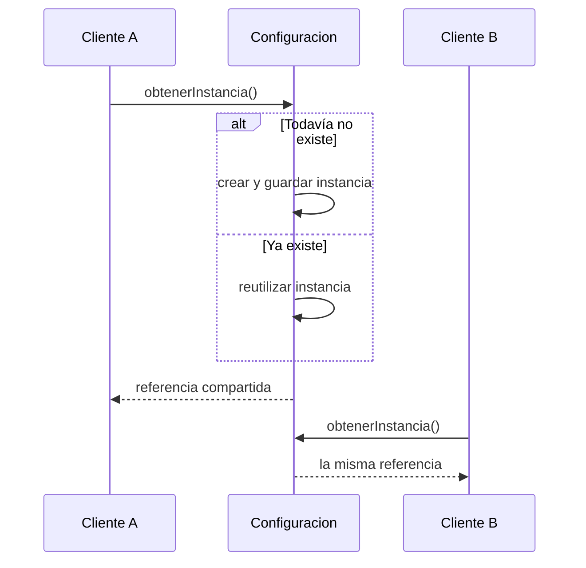

**Para comprobarte:** ¿Por qué un constructor público rompería la intención de este Singleton?

Porque un cliente podría usar new para crear objetos adicionales, salteando el control de obtenerInstancia().

### Factory Method: leer la estructura y seguir las llamadas
- Creador <|-- FabricaAuto/FabricaMoto: las clases concretas heredan y redefinen crearVehiculo(). El triángulo apunta al creador abstracto.
- Vehiculo <|.. Auto/Moto: línea discontinua y triángulo indican que cada producto implementa el contrato.
- Las dependencias 'crea' señalan quién construye cada producto. vender() utiliza Vehiculo, sin depender de Auto o Moto.

1. **Iniciar la operación**: El cliente trabaja con un creador seleccionado y pide vender().

2. **Invocar el método fábrica**: La operación heredada llama a crearVehiculo(); la redefinición de FabricaAuto decide qué construir.

3. **Entregar el producto**: El vehículo concreto responde al contrato común entregar().

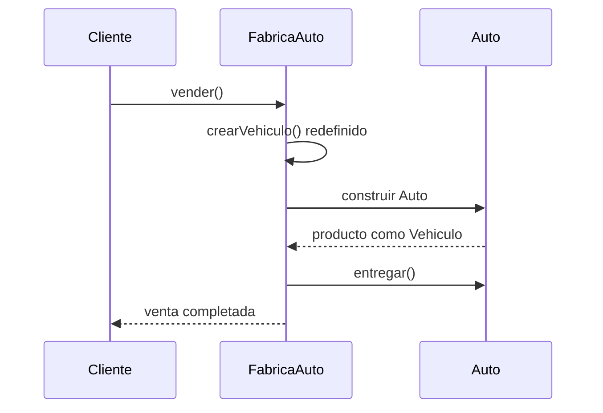

**Para comprobarte:** ¿Un método con un switch que construye todos los vehículos demuestra Factory Method GoF?

Por sí solo demuestra una fábrica simple. El rasgo que mostrás aquí es un método fábrica redefinido por creadores concretos.

### Abstract Factory: leer la estructura y seguir las llamadas
- FabricaUI declara dos métodos: uno por tipo de producto. Boton y Campo son los contratos que consume Cliente.
- FabricaWeb crea BotonWeb y CampoWeb; FabricaEscritorio crea las dos variantes de escritorio. Esa coherencia define la familia.
- Los triángulos discontinuos terminan en las interfaces. Las flechas 'crea' unen cada fábrica con sus productos concretos.

1. **Crear el botón**: Cliente pide un Boton a la fábrica Web sin invocar BotonWeb directamente.

2. **Crear el campo**: La misma fábrica entrega un Campo de la misma familia.

3. **Trabajar con contratos**: El cliente dibuja ambos productos a través de sus interfaces.

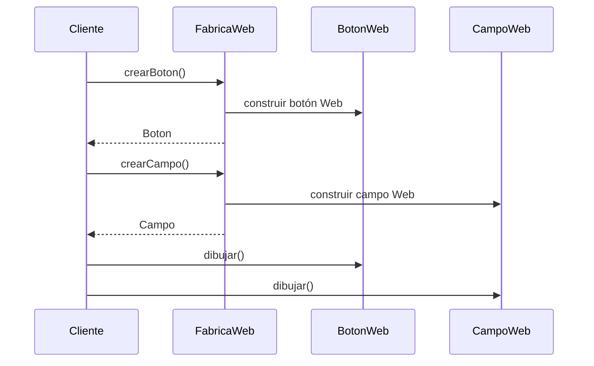

**Para comprobarte:** ¿Qué cambia al agregar un producto Menu, y qué cambia al agregar una familia Móvil?

Menu requiere crear su contrato y ampliar cada fábrica con crearMenu(). Móvil requiere una nueva fábrica que implemente los métodos existentes y sus productos correspondientes.

### Adapter: leer la estructura y seguir las llamadas
- Cliente conoce Administrable. LibroDigitalAdapter realiza ese contrato; LibroDigital no necesita modificar su interfaz.
- LibroDigitalAdapter --> LibroDigital representa la referencia al servicio existente que permite delegar.
- Este es un adaptador de objetos: usa composición de objetos y delegación. No supone herencia del servicio adaptado.

1. **Recibir el pedido**: El cliente invoca el contrato Administrable que ya usa en su negocio.

2. **Adaptar y delegar**: El adaptador comunica ese pedido al objeto LibroDigital.

3. **Devolver el resultado**: El servicio responde y el adaptador devuelve un resultado compatible al cliente.

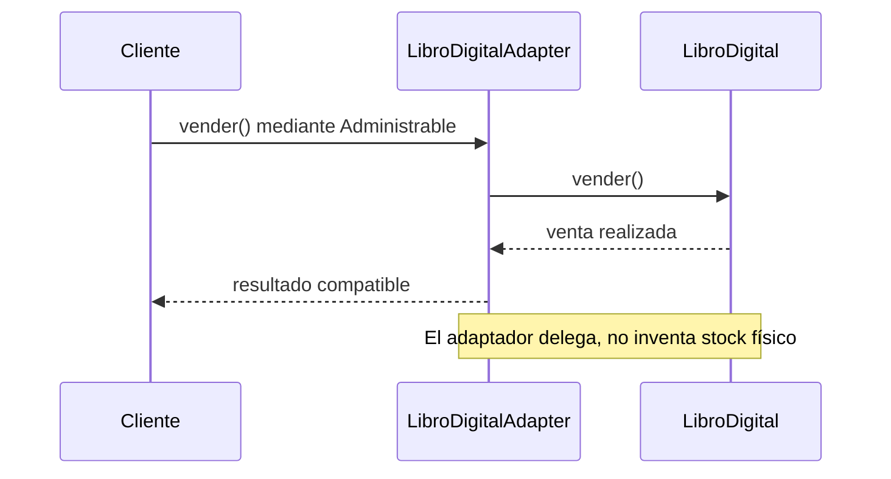

**Para comprobarte:** ¿La existencia del adaptador permite agregarStock() si el servicio no maneja stock?

No automáticamente. Hay que definir el comportamiento requerido: almacenamiento adicional, operación no aplicable o error explícito, según el dominio.

### Composite: leer la estructura y seguir las llamadas
- Archivo y Carpeta heredan Elemento y comparten tamano(). Cliente trabaja con ese contrato para ambos casos.
- Carpeta agrupa Elementos, no solo Archivos: así una carpeta puede contener otra carpeta.
- El rombo vacío expresa agregación en este ejemplo. Composite no exige rombo lleno: el ciclo de vida de las partes decide la relación UML.

1. **Consultar la raíz**: El cliente pide tamano() una vez; la carpeta organiza el recorrido.

2. **Resolver una hoja**: Archivo A devuelve el valor base de 10 bytes.

3. **Resolver el subárbol**: Subcarpeta consulta Archivo B y devuelve 20 bytes. La raíz suma 10 + 20.

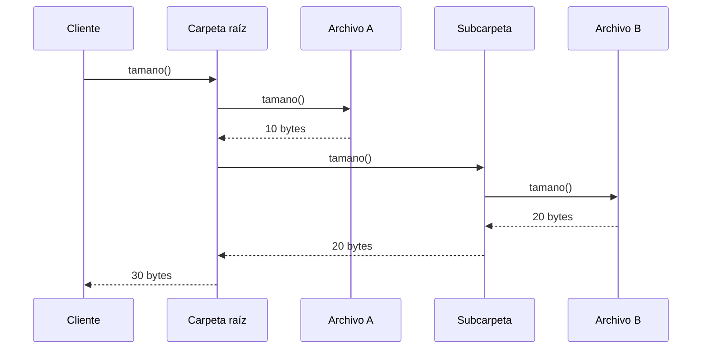

**Para comprobarte:** ¿Por qué hijos debe ser una colección de Elemento y no de Archivo?

Porque una colección de Archivo impide guardar otras carpetas. La abstracción Elemento admite hojas y compuestos, conservando la operación uniforme.

### Facade: leer la estructura y seguir las llamadas
- Cliente --> TiendaFacade muestra la entrada de alto nivel comprar(). El cliente no coordina tres subsistemas.
- Las asociaciones de la fachada con Inventario, Pedidos y Envios permiten organizar el trabajo interno.
- La fachada simplifica acceso. No elimina los subsistemas ni impide que otros clientes especializados los utilicen.

1. **Pedir una compra**: El cliente conoce una entrada simple del subsistema.

2. **Organizar los pasos**: La fachada coordina los servicios sin trasladar su lógica al cliente.

3. **Confirmar el resultado**: Después de reservar, crear y programar, la fachada responde al cliente.

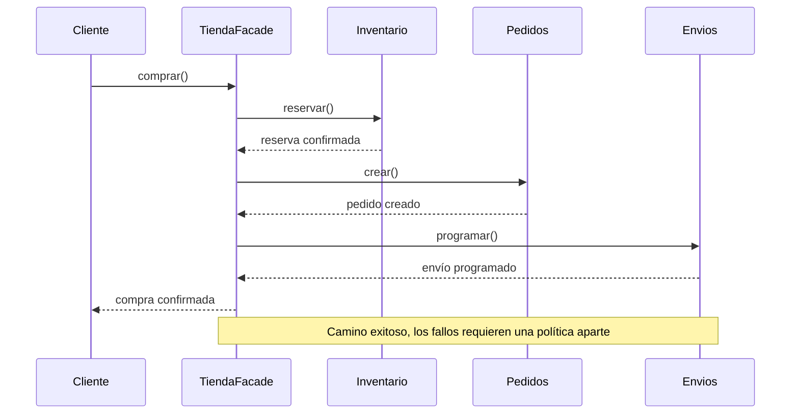

**Para comprobarte:** ¿Qué distingue esta fachada de un adaptador?

La fachada reduce la complejidad de acceso a varios servicios. El adaptador hace compatible un contrato existente con otro esperado; no basta con ser un intermediario para ser Adapter.

### Observer: leer la estructura y seguir las llamadas
- Archivo mantiene una colección de Observer. La multiplicidad 0..* permite ningún suscriptor o varios.
- ExportadorCSV/XLS/PDF implementan Observer. Archivo invoca actualizar() sin conocer cada formato concreto.
- suscribir() y desuscribir() cambian la colección durante la ejecución. Evitá dependencias directas del sujeto a cada exportador.

1. **Suscribirse**: Cada receptor solicita su registro. Archivo guarda la referencia por la interfaz Observer.

2. **Producir el evento**: Una modificación del contenido dispara notificar().

3. **Avisar y gestionar bajas**: Los receptores reaccionan; PDF puede cancelar su suscripción para eventos posteriores.

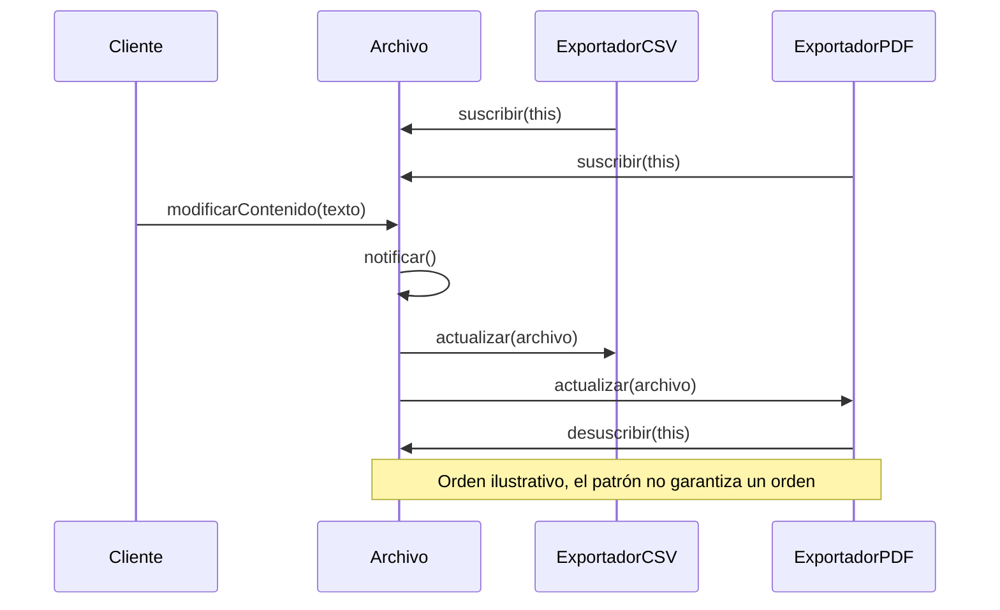

**Para comprobarte:** ¿Por qué Archivo no debería guardar listas distintas de CSV, XLS y PDF?

Porque se acoplaría a cada clase concreta y habría que modificarlo para sumar un receptor. Una colección de Observer permite usar el mismo contrato de notificación.

### Strategy: leer la estructura y seguir las llamadas
- Coche --> IComportamientoFrenos es la referencia que hace posible delegar. La herencia de estrategias por sí sola no basta.
- FrenoNormal y FrenoABS implementan la interfaz; el triángulo apunta al contrato, no a la variante.
- setFrenos() permite cambiar el objeto estrategia. Coche usa frenar() sin conocer cómo funciona cada algoritmo.

1. **Elegir la variante**: El cliente instala FrenoNormal en el contexto.

2. **Delegar**: Coche recibe frenar() y llama al algoritmo normal seleccionado.

3. **Cambiar sin rehacer el contexto**: El cliente instala FrenoABS; la siguiente llamada se delega a ABS.

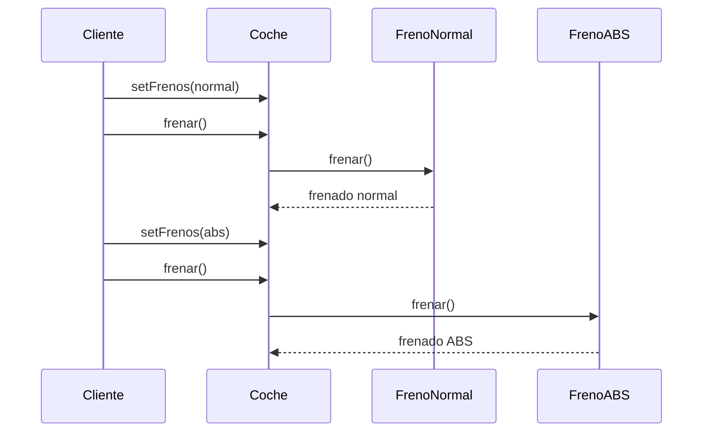

**Para comprobarte:** ¿Qué cambiaría si Coche notificara simultáneamente a todos los frenos registrados?

Ya no mostraría la intención de Strategy: resolver una tarea con una variante seleccionada. La difusión de un evento a varios receptores corresponde al problema de Observer.

### Un mapa para elegir sin memorizar dibujos

Elegí por el problema: una instancia, creación variable, contratos incompatibles, árboles, una entrada simple, eventos o algoritmos. El dibujo sirve para justificar la decisión.

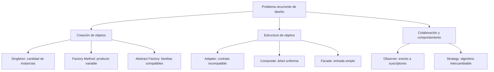

Mapa conceptual, no flujo de ejecución. Reúne los ocho patrones desarrollados por el material.
- Las ramas clasifican por propósito; una aplicación puede combinar varios patrones.
- La señal de la consigna importa más que la forma del dibujo.

### Del requisito a una evidencia de calidad

Ejemplo didáctico: una meta de respuesta se convierte en una prueba, una medición y una decisión. Los valores son ilustrativos, no resultados observados ni umbrales universales.

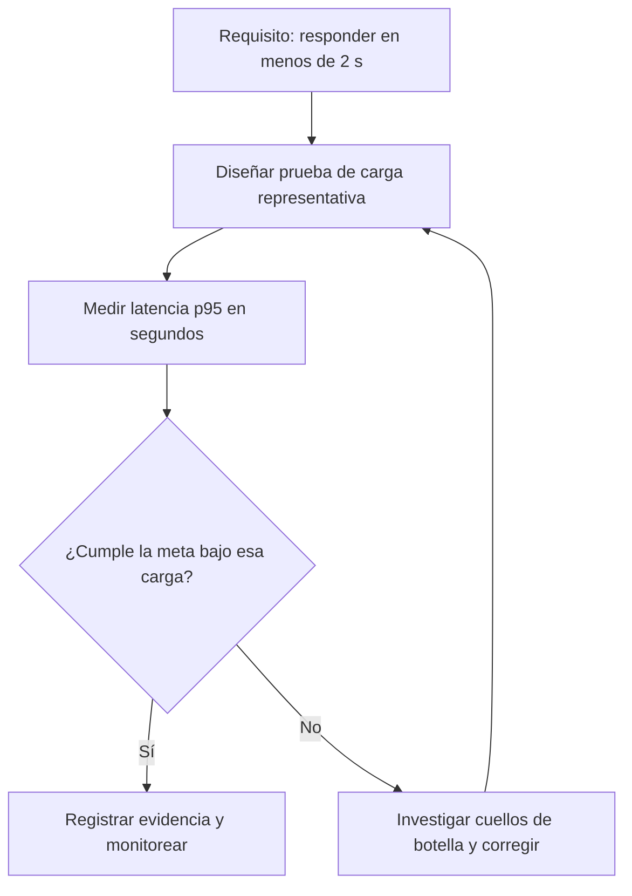

Cumplir una métrica de rendimiento no demuestra por sí solo seguridad, usabilidad ni calidad total.
- La decisión incluye unidad, carga de prueba y umbral definido.
- Después de corregir se vuelve a medir bajo condiciones comparables.

### AS-IS → TO-BE con una comprobación

Mejorar un proceso necesita una situación inicial, una meta y un seguimiento. Automatizar una tarea no demuestra que el proceso completo haya mejorado.

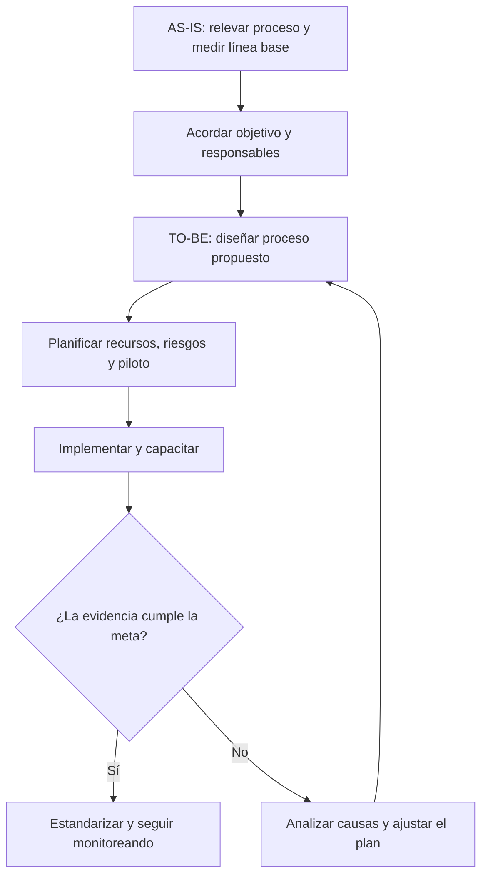

Esquema de estudio de mejora de procesos: conecta personas, método y herramientas con un resultado comprobable.
- AS-IS describe lo actual; TO-BE describe la propuesta, no un resultado ya alcanzado.
- El piloto y la evaluación evitan dar por exitosa una mejora solo porque se implementó.

### Reconocer el nivel por la evidencia

Esta progresión representa los cinco niveles utilizados en las guías. Es un mapa de estudio, no una evaluación oficial ni una certificación de una organización.

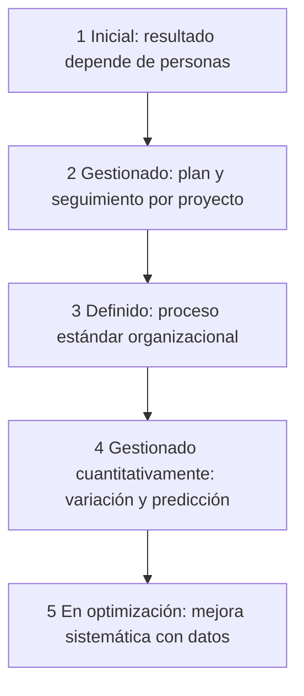

Tener herramientas o una planilla de métricas no alcanza para afirmar nivel 4; buscá cómo se usan para controlar y predecir.
- Los niveles acumulan capacidad de gestión; no son estados de un producto individual.
- La diferencia entre 2 y 3 es el alcance: proyecto frente a estándar organizacional.

### Un cambio necesita decisión y trazabilidad

Control de cambios decide qué se aprueba; control de versiones conserva qué se modificó. Un commit no equivale a la aprobación de una solicitud.

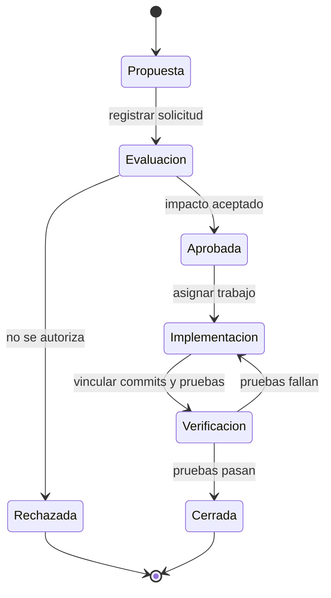

Modelo didáctico de estados de una solicitud. Los commits aportan trazabilidad al trabajo aprobado.
- Cada flecha representa un cambio de estado con una condición o evento.
- Git ayuda a rastrear el código; no reemplaza la evaluación del impacto ni las reglas de aprobación.

### Add, commit y push hacen cosas distintas

El índice contiene una selección de cambios. El commit guarda esa selección en el historial local; push intenta transferir commits al remoto y puede ser rechazado.

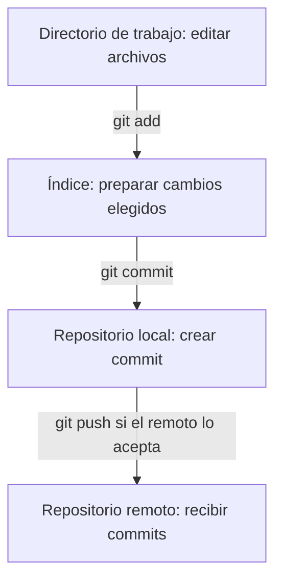

Este esquema muestra transferencia de información; las etapas previas siguen existiendo. Los conflictos se trabajan en Git Lab.
- Editar después de add no actualiza automáticamente lo preparado.
- Commit puede hacerse sin conexión; push necesita acceso al remoto y permisos.

### GQM: empezar por la decisión

Ejemplo de una mesa de ayuda: primero definís el objetivo, luego las preguntas que lo vuelven comprobable y finalmente los datos y métricas. Los umbrales se acuerdan antes de interpretar resultados.

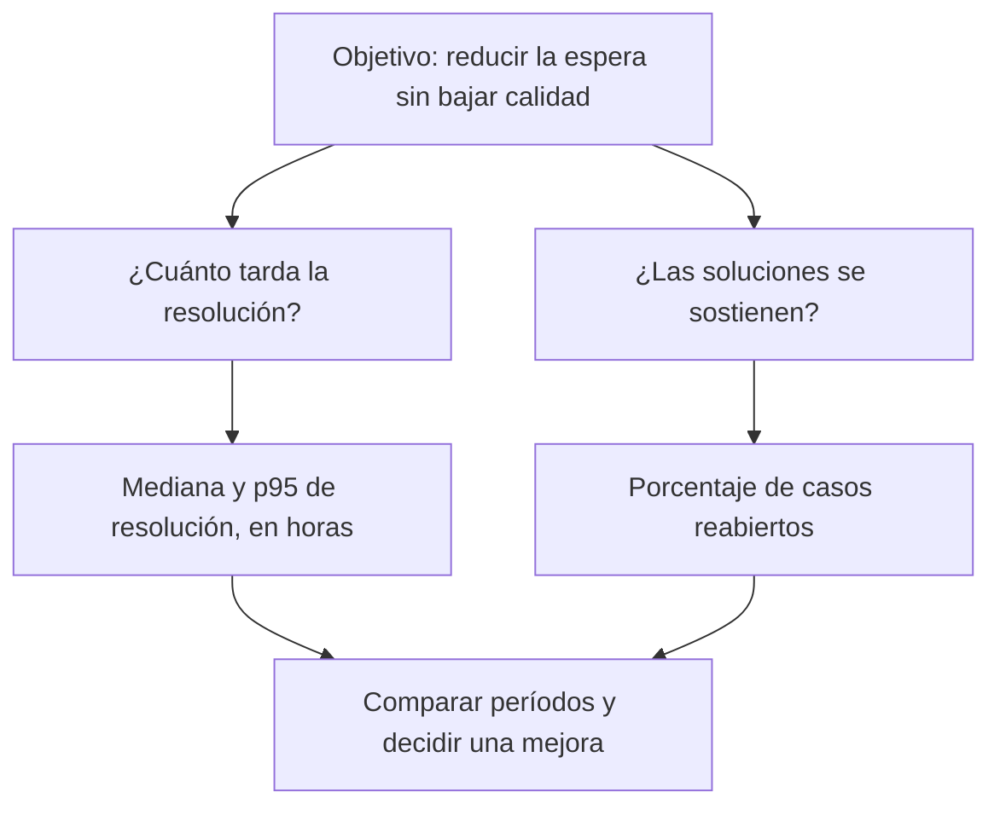

Un tiempo menor con muchas reaperturas puede indicar una mejora aparente. Combiná rapidez y calidad de la resolución.
- Goal define lo que querés mejorar; Question fija qué necesitás conocer; Metric define cómo lo medís.
- Registrá población, período, unidad y criterio de reapertura para que los valores sean comparables.
